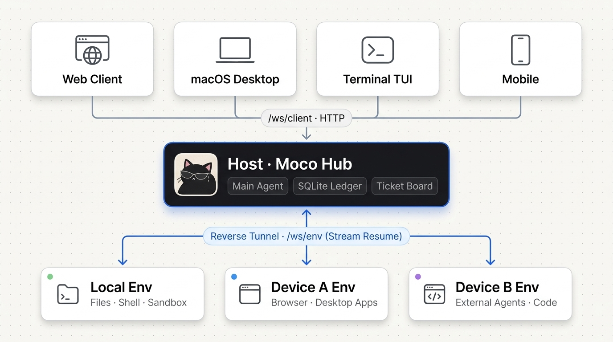
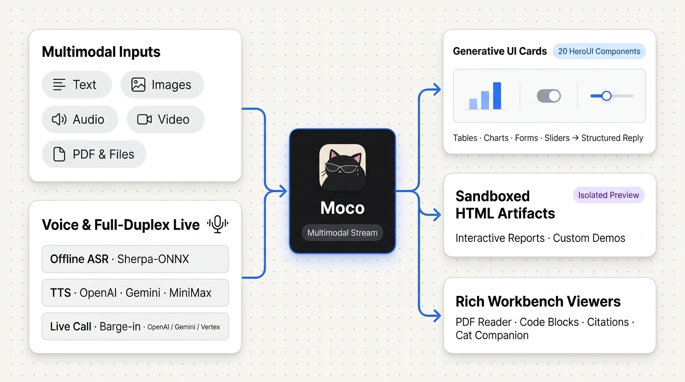
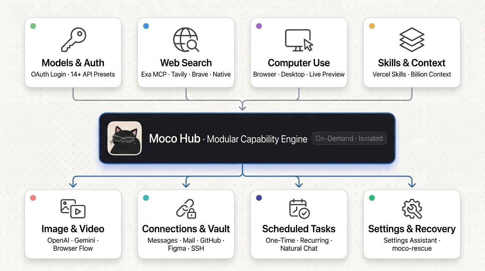

<p align="center">
  
</p>

<h1 align="center">Moco</h1>

<p align="center"><strong>Your always-on personal SuperAgent, across devices.</strong></p>

<p align="center">
  English | <a href="README.zh-CN.md">简体中文</a>
</p>

<p align="center">
  <a href="https://github.com/moonoops/moco/releases"></a>
  <a href="https://github.com/moonoops/moco/stargazers"></a>
  <a href="LICENSE"></a>
  
  = 22.20">
</p>

Moco is a self-hosted, always-on personal agent that stays continuous across your devices. You keep talking to the same Moco: it holds your shared identity and working relationship, coordinates built-in Workers and native external agents across different machines in isolated workspaces, and brings verified results back to one place—combining text, voice, Live calls, Generative UI, and background execution.

[Multi-device](#multi-device) · [SuperAgent & Workers](#superagent) · [Multimodal & Voice](#multimodal) · [Memory & Security](#memory-security) · [Capabilities](#capabilities) · [Quick start](#quick-start) · [Development](#development)

<a id="multi-device"></a>
## One Moco, across your devices

Run a **Host (`@moco/hub`)** on your computer or server, then connect additional **Execution Nodes (`@moco/env`)**. The Hub runs the persistent main agent, stores conversations and task state in a single SQLite ledger, and coordinates work. Each Env provides an isolated runtime where files, tools, browsers, desktops, and external agents actually run.



- **Decoupled conversation and execution**: Ask from your phone or laptop while a Worker edits code on a workstation or operates a browser on another machine. A Host can also run its own local Env, so you can start on a single computer and add devices later.
- **Resilient reverse tunnels (`/ws/env`)**: Execution nodes connect outbound to the Hub with per-node credentials—no public IP required on worker machines—and maintain cumulative-ACK stream resume buffers to survive brief network drops without losing output.
- **Three ways to add devices**: Run a one-time pairing command (`moco join`), deploy automatically over SSH, or **paste a pairing invitation directly into chat** to join or re-associate a device.
- **Device-aware routing**: Moco recognizes local signals (paths, `localhost` ports, desktop/browser references) and pins tasks to the intended device. When a target device is offline, Moco reports it instead of silently executing elsewhere.
- **Optional Android companion pairing**: Supports QR-code pairing over a managed TLS connector, granular Android device permissions, and mobile notification delivery.

Moco builds on [Pi Durable](https://github.com/earendil-works/pi/tree/main/packages/durable) for durable agent sessions, [Pi Env](https://github.com/earendil-works/pi/tree/main/packages/env) for execution environments, and [Pi AI](https://github.com/earendil-works/pi/tree/main/packages/ai) for unified model streaming and OAuth flows.

<a id="superagent"></a>
## SuperAgent: one main agent, parallel execution behind it

### Different topics, the same Moco

The main agent is your single ongoing point of contact. Creating a topic opens a dedicated workspace while keeping the same identity, relationship, and coordinating role. Each topic retains its own messages and task context, while permitted cross-topic history is searchable through a local SQLite FTS5 index. Client delivery uses `/ws/client` request acknowledgements (`hub.ack`) backed by an IndexedDB outbox for reliable resend.

### Quasi-full-duplex: interrupt, steer, and switch topics

You can keep talking while Moco is thinking, streaming a reply, or coordinating background Workers. Add a constraint, change direction, check progress, or switch to another topic—new input is absorbed at the next processing boundary and can steer running tasks (`moco_steer`) without waiting for long jobs to finish. Switching topics never cancels dispatched work; results return to their owning topic.

### Built-in Workers, subagents & parallel staged workspaces


- **Six customizable built-in roles**: **Scout** (read-only reconnaissance), **Architect** (design & subagent orchestration), **Coder** (implementation & test verification), **Checker** (independent read-only audit), **Designer** (visual & interaction craft), and **Writer** (clear drafting & editing). Each role supports independent model, thinking effort, prompt, and permission overrides.
- **Live Ticket Board & subagents**: Bounded concurrency scheduling with incremental board updates, retry/stop controls, escalation questions, and per-ticket subagents (`moco_subagent`) for complex multi-step work.
- **Parallel staged workspaces**: Built-in and external code tasks can execute inside isolated copy-on-write / cloned task workspaces so concurrent Workers do not step on each other. Read-only violations are automatically discarded, and the main agent inspects staged diffs before applying or discarding changes.
- **Tiered dynamic tool surface**: Tools are partitioned by audience (chat, settings, computer workers, Android workers) into resident, event-triggered, and deferred tiers to keep prompts focused and privileges minimal.

### Native external agents with task-scoped MCP

Moco delegates seamlessly to external coding agents installed on your execution devices:

- **Supported**: **Codex** (App Server), **Claude Code** (native SDK/CLI), **Antigravity** (`agy acp`), and **DeepSeek Harness** (`dsh --profile acp`).
- **Experimental**: **Grok Bot** local bridge (plus reserved setup guides for ChatGPT Dots and Meta Muse).

External agents run on their bound device using their own native accounts, tools, and permissions—Moco never asks for their credentials in chat—while exposing task-scoped Moco MCP tools (`moco_task_context`, `moco_task_report`, `moco_request_collaboration`, `moco_child_task`, authorized shared memory, and approved connections).

<a id="multimodal"></a>
## Multimodal, Generative UI, voice & workbench



### Rich multimodal conversation & Generative UI

Moco accepts text, images, audio, video, and arbitrary files, with inline media previews, a built-in PDF viewer (with per-file reading-position memory), syntax-highlighted code blocks, reply references, a conversation outline & library, and persistent source citations.

- **Generative UI (`json-render` + HeroUI v3)**: The agent can render interactive components directly in the conversation from a 20-component registered catalog—including tables, bar/line charts, forms, single/multi-select choices, sliders, switches, checkboxes, tabs, disclosures, metrics, media, and code—and receive structured user submissions to continue the workflow.
- **Sandboxed HTML artifacts**: For bespoke visualizations or interactive deliverables, Moco can publish self-contained HTML artifacts rendered inside an isolated preview sandbox.

### Voice: offline ASR, TTS & full-duplex Live calls

- **Speech-to-text (ASR)**: Supports local offline **Sherpa-ONNX** speech recognition as well as configured model providers.
- **Text-to-speech (TTS)**: Supports **OpenAI**, **Gemini**, and **MiniMax** (CN / Global) with configurable voices and speed.
- **Full-duplex Live calls**: Real-time voice conversations with live transcripts and barge-in interruption via **OpenAI**, **Gemini**, or **Vertex AI**. Live sessions share the active topic's context, can hand off background tasks to the main agent, and keep dispatched tasks running after you hang up.

### Web, macOS Desktop & terminal clients

- **Three-pane HeroUI v3 workbench (`@moco/web`, `@moco/desktop`)**: Light and dark themes, interactive animated Cat companion (`CatAvatar` with customizable picker), and keyboard shortcuts across Desktop and Web:
  - `⌘/Ctrl+K` search conversations · `⌘/Ctrl+F` find in conversation · `⌘/Ctrl+\` / `⇧⌘/Ctrl+\` toggle left/right panels · `⌘/Ctrl+.` stop generation · `⇧⌘/Ctrl+C` copy last reply · `⌘/Ctrl+S` save · Desktop menu: `⌘/Ctrl+N` new topic · `⌘/Ctrl+,` settings · `⌘/Ctrl+1` return to main chat.
- **Interactive terminal TUI (`@moco/cli`)**: Connect directly from the terminal with `moco dev` or `moco chat`.

<a id="memory-security"></a>
## Memory with boundaries & security by design


### Private identity & relationship documents

Moco maintains two private documents in `<MOCO_STATE_DIR>/identity`—`identity-agreement.md` (edited via explicit dual-confirmation Diff review with SHA-256 + CAS locking and backups) and `relationship.md` (editable by you or tidied autonomously when idle). Both are **strictly private to the main agent** and physically inaccessible to Workers and external agents.

### Optional Hindsight dual-bank semantic memory

Enable the optional **Hindsight** integration for long-term semantic recall, reflection, and knowledge pages—either with **one-click local managed deployment** from Settings or by connecting an existing `hindsight-api-slim==1.2.1` instance loaded with `integrations/hindsight`. Role isolation (`moco-core` vs. `moco-shared`) is enforced server-side inside the Hindsight process via separate Bearer credentials (`MOCO_HINDSIGHT_ROUTER_API_KEY` vs. `MOCO_HINDSIGHT_WORKER_API_KEY`) with negative probe verification on startup. Hindsight is disabled by default; see [integrations/hindsight/README.md](integrations/hindsight/README.md) for deployment details.

### Credential vault, OS sandboxing & recovery

- **OS keychain vault & Connections**: Store credentials in the system keychain (macOS Keychain / Linux Secret Service / Windows Credential Manager) for built-in app connectors (**Apple Messages**, **Apple Mail**, **GitHub**, **Figma**), **SSH** hosts, and custom credentials. Inbound secrets pasted into chat are detected and redacted automatically before hitting history; Workers must request explicit per-task approval to use a connection.
- **Provider credential isolation**: Built-in OAuth subscriptions and custom API keys live under isolated provider IDs so they never clobber each other, and stored API keys are strictly bound to their saved service origin.
- **OS-level Worker sandboxing**: Built-in Workers run inside macOS Seatbelt, Linux Bubblewrap, or Windows restricted isolation, shielding Hub state and sensitive home directories (`.ssh`, `.gnupg`, `.kube`, `.aws`, `.claude`, `.codex`, `.gemini`).
- **Managed desktop UI customization & `moco-rescue`**: On macOS Desktop, Moco supports modifying its own Web UI in an isolated candidate build, verifying startup readiness, checking Ed25519 signatures for official updates, and automatically rolling back failed launches. The standalone `moco-rescue` CLI remains outside the main app to inspect releases, roll back, enter safe mode, clean up stale executions, or export redacted diagnostics.

<a id="capabilities"></a>
## Capabilities at a glance



<details>
<summary>View full capability & provider breakdown</summary>

| Capability | Details |
| --- | --- |
| **Models & auth** | Built-in OAuth subscriptions (via Pi AI lazy-oauth: OpenAI/Codex, Anthropic, OpenRouter, GitHub Copilot, Kimi Coding, xAI, etc.) plus API presets (OpenAI, Gemini, Vertex AI, Anthropic, DeepSeek, OpenRouter, xAI, Moonshot, MiniMax, Z.AI, Qwen, Groq, Mistral, and custom OpenAI-compatible gateways). |
| **Web search** | Multi-plan search with priority fallback: keyless **Exa** MCP preset, **Tavily**, **Brave**, and optional **DuckDuckGo**, plus per-model native web search toggle and persistent citations. |
| **Computer use** | Enabled by default per Env via `agent-browser` and `agent-desktop`, with live preview streaming and OS permission checks. Control per device with `MOCO_COMPUTER_USE`. |
| **Skills & extensions** | Conditional preset skills (browser/desktop automation, React & web design guidelines, GenUI cards, capability setup), Vercel `skills` discovery & project skills, plus optional **Billion Context / `acp-kernel`** long-context compression. |
| **Image & video** | Built-in OpenAI & Gemini image generation/editing presets (with multi-reference support) plus browser-session Flow integration for media jobs. |
| **Connections** | Keychain-backed Apple Messages, Apple Mail, GitHub, Figma, SSH, and custom credentials with chat redaction and per-task approval gates. |
| **Scheduled tasks** | One-time and recurring tasks scheduled and managed in natural conversation. |
| **Settings assistant** | Dedicated conversational assistant inside Settings to configure models, search, Hindsight, devices, skills, and connections safely. |

</details>

<a id="quick-start"></a>
## Quick start

### 1. Run locally from source

Requires **Node.js ≥ 22.20.0** and **pnpm 11.25.0**:

```sh
git clone https://github.com/moonoops/moco.git
cd moco
pnpm install
cp .env.example .env
```

Edit `.env` and set `MOCO_AUTH_TOKEN` to a unique random secret (at least 32 characters recommended). Replace `MOCO_BASE_URL`, `MOCO_API_KEY`, and `MOCO_MODEL` with your provider settings—or clear them and configure models/OAuth directly in the Web UI after launch. See [.env.example](.env.example) for all options.

```sh
pnpm build
node packages/cli/dist/bin.js open
```

`open` starts the Hub and built-in local Env, then opens an authenticated browser window at `http://localhost:7788`.

### 2. macOS desktop app (macOS 14+)

Build and install the standalone macOS desktop app (`Moco Dev`) for your machine's architecture:

```sh
pnpm desktop:install --launch
```

The desktop app maintains its own data directory and settings separate from the source workspace's `.env`. For iterative development, use `pnpm desktop:dev` (desktop app) or `pnpm dev` (terminal TUI).

### 3. Connect additional devices & browser runtime

- **Add a device**: Open **Settings → Device interconnection → Add device** and run the generated one-time pairing command on the target machine, use SSH-assisted deployment, or paste the invitation directly into chat. On a device with Moco already built from source, run:
  ```sh
  node packages/cli/dist/bin.js join --hub <host-address> --invite <invitation>
  ```
- **Browser automation runtime**: Browser tasks require Chrome or Chromium. On a source-based execution node, install the managed browser binary with:
  ```sh
  pnpm --filter @moco/env exec agent-browser install
  ```

### CLI quick reference

| Command | Purpose |
| --- | --- |
| `node packages/cli/dist/bin.js open [--no-open]` | Start Hub + local Env and open the authenticated Web UI |
| `node packages/cli/dist/bin.js dev [--port 7788] [--no-tui] [--standalone]` | Connect to paired Hub or start a standalone local Hub + TUI |
| `node packages/cli/dist/bin.js join --hub <url> --invite <token> [--root ~/Moco]` | Pair this machine as an Env node under an existing Hub |
| `node packages/cli/dist/bin.js hub [--host 0.0.0.0] [--port 7788] [--no-local-env]` | Run a standalone Hub server |
| `node packages/cli/dist/bin.js env --connect <ws-url> --id <env-id> --token <node-token>` | Run a standalone execution node connected to a Hub |
| `node packages/cli/dist/bin.js chat [--url ws://127.0.0.1:7788/ws/client] [--token <token>]` | Open the interactive terminal TUI client |
| `moco-rescue <inspect\|versions\|rollback\|export\|gc\|safe-mode\|cleanup> --data-dir <path>` | Independent version diagnosis, rollback, and recovery tool |

<a id="platforms"></a>
## Platform support

| Component | Current scope |
| --- | --- |
| **Web client** | Modern desktop, tablet, and mobile browsers |
| **Desktop app** | macOS 14+ (Electron shell + portable Node runtime; packaging currently targets macOS) |
| **Hub** | Node.js ≥ 22.20 service (macOS / Linux / Windows); task execution requires at least one connected Env |
| **macOS Env** | Built-in Seatbelt sandbox; desktop automation requires Accessibility & Screen Recording permissions |
| **Linux / Windows Env** | Execution nodes with Bubblewrap (Linux) or restricted Windows isolation; desktop automation requires an interactive graphical session |

<a id="faq"></a>
## FAQ

**Do I need multiple devices to use Moco?**
No. One computer can run both the Hub and its built-in local Env; add other devices whenever you want.

**Does self-hosting mean models run locally?**
You self-host the Hub, SQLite state, identity documents, and execution nodes. Inference runs wherever your configured providers point—local models or cloud APIs/OAuth subscriptions.

**Why can't I record voice or start a Live call from my phone over LAN HTTP?**
Browser microphone capture and Live voice require a secure context (`https://` or `localhost`) plus microphone permission. Plain `http://<lan-ip>` origins are restricted by browsers.

<a id="development"></a>
## Development & contributions

Moco is a TypeScript + pnpm monorepo:

| Package | Responsibility |
| --- | --- |
| [`packages/hub`](packages/hub) | Main agent orchestrator, Ticket Board, HTTP/WS server, tools, memory, vault & SQLite ledger |
| [`packages/env`](packages/env) | Execution nodes, OS sandboxing, staged workspaces, computer use & external agent drivers |
| [`packages/web`](packages/web) | React 19 + Vite + Tailwind CSS v4 + HeroUI v3 workbench |
| [`packages/desktop`](packages/desktop) | Electron macOS desktop shell, native menus, shortcuts & packager |
| [`packages/cli`](packages/cli) | CLI entrypoint and terminal TUI |
| [`packages/protocol`](packages/protocol) | Shared domain types, schemas, tool catalogs & protocol contracts |
| [`packages/recovery`](packages/recovery) | Release manifest verification, auto-rollback & standalone `moco-rescue` runtime |
| [`integrations/hindsight`](integrations/hindsight) | In-process dual-bank memory authorization extension for Hindsight 1.2.1 |

Run the full verification suite before opening a PR:

```sh
pnpm typecheck
pnpm build
pnpm test
```

If you change the Hindsight integration, also run its Python test suite (requires `uv`):

```sh
pnpm test:hindsight
```

Issues, ideas, and pull requests are welcome. Include reproduction steps and redacted logs in bug reports, keep English and Chinese READMEs in sync, and check [CHANGELOG.md](CHANGELOG.md), [.env.example](.env.example), [integrations/hindsight/README.md](integrations/hindsight/README.md), and [THIRD_PARTY_NOTICES.md](THIRD_PARTY_NOTICES.md) for details.

<a id="acknowledgements"></a>
## Acknowledgements

Moco stands on the shoulders of open-source projects and communities. Thank you to:

- [Pi](https://github.com/earendil-works/pi) — Pi Durable, Pi Env, Pi AI, Pi Schema, and Chord power persistent sessions, model streaming, and execution environments.
- Vercel Labs — [json-render](https://github.com/vercel-labs/json-render), [skills](https://github.com/vercel-labs/skills), [agent-skills](https://github.com/vercel-labs/agent-skills), [agent-browser](https://github.com/vercel-labs/agent-browser), and [agent-desktop](https://github.com/vercel-labs/agent-desktop).
- [acp-kernel](https://github.com/ranxianglei/acp-kernel) and [Billion Context](https://github.com/ranxianglei/billion-context) for optional long-context compression.
- [Hindsight](https://github.com/vectorize-io/hindsight) for dual-bank long-term semantic memory.
- [HeroUI](https://github.com/heroui-inc/heroui) for v3 interface components.
- [Sherpa-ONNX](https://github.com/k2-fsa/sherpa-onnx) for local offline speech recognition.
- [LINUX DO](https://linux.do/) for community discussions and knowledge sharing.

See [THIRD_PARTY_NOTICES.md](THIRD_PARTY_NOTICES.md) for dependency licenses and retained attributions.

<a id="license"></a>
## License

Moco's original code is licensed under the **GNU Affero General Public License v3.0 only (AGPL-3.0-only)**. See [LICENSE](LICENSE) for full terms. Third-party dependencies, bundled skills, and upstream assets retain their own licenses; see [THIRD_PARTY_NOTICES.md](THIRD_PARTY_NOTICES.md).

<a id="star-history"></a>
## Star History

<a href="https://www.star-history.com/?repos=moonoops%2Fmoco&type=date&legend=top-left">
 <picture>
   <source media="(prefers-color-scheme: dark)" srcset="https://api.star-history.com/svg?repos=moonoops/moco&type=Date&theme=dark" />
   <source media="(prefers-color-scheme: light)" srcset="https://api.star-history.com/svg?repos=moonoops/moco&type=Date" />
   
 </picture>
</a>
