<p align="center">
  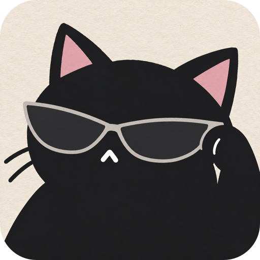
</p>

<h1 align="center">Kulo</h1>

<p align="center"><strong>Your Always-On, Cross-Device Personal Agent & Multi-Agent Command Center.</strong></p>

<p align="center">
  English | <a href="README.zh-CN.md">简体中文</a>
</p>

<p align="center">
  <a href="https://github.com/moonoops/Kulo/releases"></a>
  <a href="https://github.com/moonoops/Kulo/stargazers"></a>
  <a href="LICENSE"></a>
  
  
  = 22.20">
</p>

<p align="center">
  <a href="#why-kulo">Why Kulo</a> ·
  <a href="#showcase">Screenshots</a> ·
  <a href="#quick-start">Quick Start</a> ·
  <a href="#multi-device">Multi-Machine Cluster</a> ·
  <a href="#superagent">External ACP Agents</a> ·
  <a href="#multimodal">Voice, UI &amp; Handoff</a> ·
  <a href="#memory-security">Privacy &amp; Safety</a> ·
  <a href="#capabilities">CLI &amp; Capabilities</a>
</p>

<p align="center">
  <picture>
    <source media="(prefers-color-scheme: dark)" srcset="assets/readme/hero-dark-en.png">
    <source media="(prefers-color-scheme: light)" srcset="assets/readme/hero-light-en.png">
    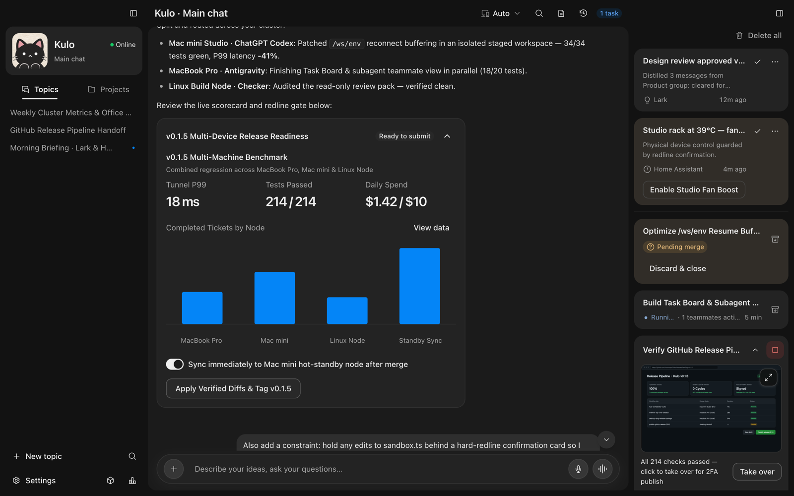
  </picture>
  <br>
  <sub><em>Kulo v0.1.5 real workbench (adapts automatically to GitHub dark/light theme): persistent main brain, live Generative UI scorecard, Lark &amp; Home Assistant proactive awareness cards, parallel cross-device tickets, and interactive Computer Preview.</em></sub>
</p>

---

<a id="why-kulo"></a>
## Why Kulo?

You already have **Antigravity**, **ChatGPT / Codex**, **Claude Code**, **Cursor**, and **Gemini CLI** installed across your laptop, Mac mini, and Linux servers—plus your phone in your pocket. Yet the more AI tools you collect, the more **you** become their full-time project manager: copying context across ten windows, checking terminals on another machine, and juggling disconnected tabs.

**Kulo is an open-source, self-hosted Personal Agent built to end tool fragmentation.** Instead of giving you another multi-tab wrapper, Kulo puts **one continuous brain** in charge of every device and agent you own:

- **One persistent brain, across every device**: Whether you message from macOS, Web, Terminal TUI, or your phone, you always talk to the *same* Kulo. Interrupt mid-thought, steer running tasks, or switch topics freely—background work never gets killed and delivers results right back where they belong.
- **Unite every agent you already pay for**: Six customizable built-in specialist roles (**Scout, Architect, Coder, Checker, Designer, Writer**) work side-by-side with **10+ external ACP agents** already installed on your machines using their native accounts and live quota probing.
- **True multi-machine cluster + hot standby**: Connect laptops, Mac minis, and Linux servers over outbound resumable reverse tunnels (`/ws/env`)—no public IP needed—with device-aware routing and primary/standby multi-host automatic failover.
- **Far beyond coding**: Full-duplex **Live voice calls** (dispatch work by voice, hang up while it keeps running), **20-component Generative UI**, inline vector diagrams, zero-dependency **Word / multi-sheet Excel / PowerPoint / PDF** previews, live **browser & desktop Computer Handoff**, **24/7 proactive assistant briefings** (Lark/Feishu, Spark Mail, Home Assistant), and **standard MCP + Composio/Zapier** connectors.
- **Built to run 24/7 behind hard boundaries**: Private identity documents and `kulo-core` memory stay physically inaccessible to Workers and external agents; execution runs inside OS sandboxes (**Seatbelt / Bubblewrap**); three **hard-redline confirmation cards** gate high-risk actions; and **daily/weekly spend caps** keep costs predictable.

### How Kulo differs from chatbots & coding-thread GUIs

| Dimension | Single-Chat AI Apps | Coding-Thread Tab GUIs (e.g. T3 Code) | **Kulo (Personal Agent)** |
| --- | --- | --- | --- |
| **Interaction model** | 1-to-1 stateless chat | 1-to-N manual thread tabs you babysit | **1-to-1-to-N persistent brain** that plans, dispatches, cross-reviews & reports back |
| **Device topology** | Cloud sandbox or single laptop | Single dev machine (optional remote view) | **True multi-machine mesh** (`/ws/env` reverse tunnels) + **multi-host hot standby failover** |
| **Agent ecosystem** | Single vendor lock-in | Coding CLIs only | **6 built-in roles + 10+ external ACP agents** (native logins, live quotas, staged isolation) |
| **Scope of work** | Text & basic tools | Code editing & git worktrees | **Full personal workbench**: code, live desktop handoff, Generative UI, Office/PDF preview, Live voice, Lark/Mail/Smart Home, MCP |
| **Trust & safety** | Flat prompt context | Shared workspace permissions | **Physically isolated private memory (`kulo-core`)**, OS sandboxes, 3 hard-redline approval cards, daily/weekly spend caps |

---

<a id="showcase"></a>
## Product tour — real Kulo UI

Every screenshot below is captured directly from **Kulo v0.1.5** (`packages/web`).

<table>
  <tr>
    <td width="50%" valign="top">
      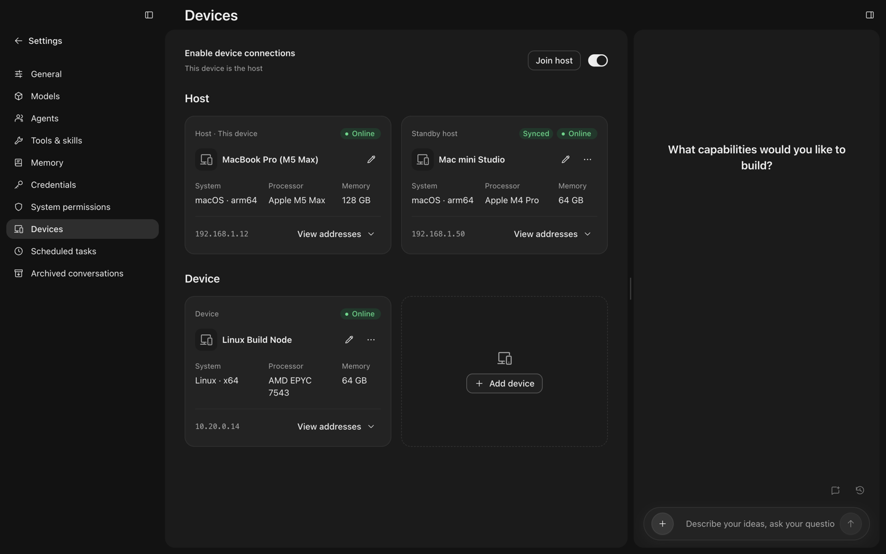
      <br><strong>Multi-Machine Cluster &amp; Hot Standby</strong><br>
      <sub>Connect MacBooks, Mac minis, and Linux servers over outbound resumable <code>/ws/env</code> tunnels. Designate a warm standby Hub for automatic failover and lossless failback.</sub>
    </td>
    <td width="50%" valign="top">
      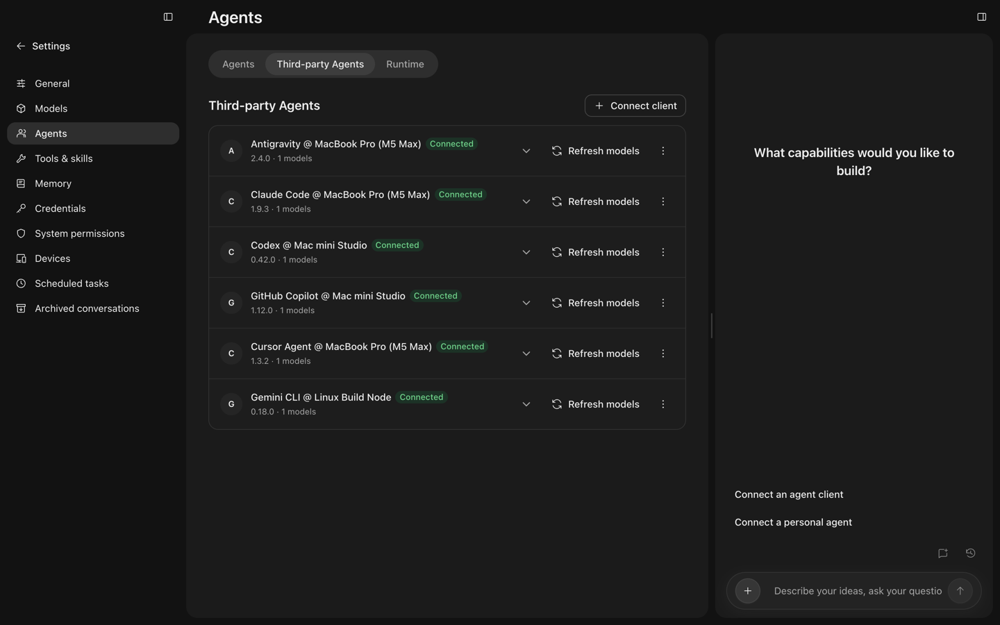
      <br><strong>10+ External ACP Agents + 6 Built-In Roles</strong><br>
      <sub>Auto-discover Antigravity, Claude Code, ChatGPT Codex, GitHub Copilot, Cursor, Gemini CLI, and custom ACP agents across every node using their native accounts.</sub>
    </td>
  </tr>
  <tr>
    <td width="50%" valign="top">
      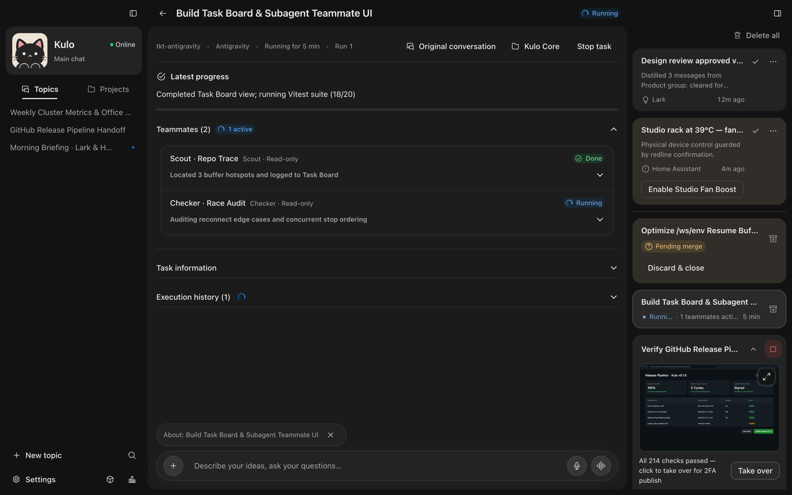
      <br><strong>Isolated Staged Workspaces &amp; Subagent Teammates</strong><br>
      <sub>Inspect live Scout &amp; Checker teammate progress, main-agent-gated Task Boards, and staged diffs before anything touches your working repository.</sub>
    </td>
    <td width="50%" valign="top">
      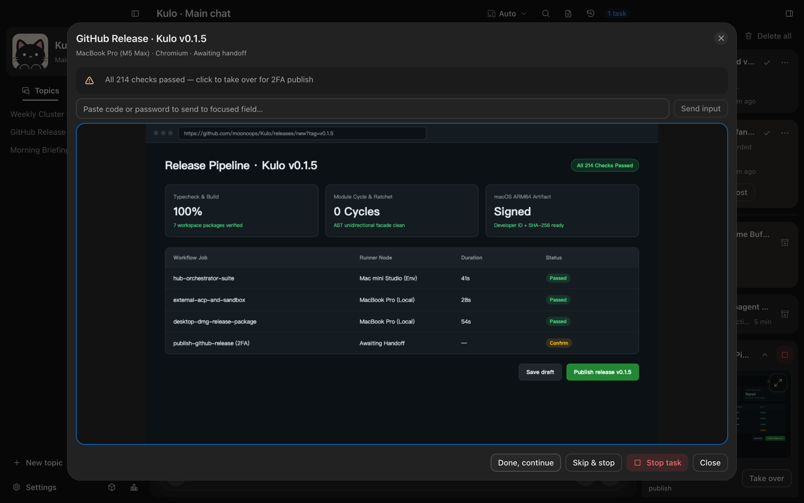
      <br><strong>Live Computer Use &amp; One-Click Handoff</strong><br>
      <sub>Watch Kulo automate browsers and desktop apps in real time—click once to take over for 2FA/login or fine adjustments, then hand control right back.</sub>
    </td>
  </tr>
  <tr>
    <td width="50%" valign="top">
      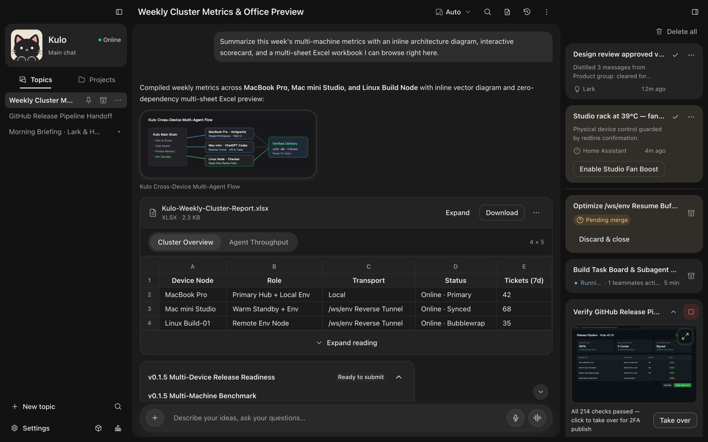
      <br><strong>Inline Diagrams, Zero-Dep Office &amp; Generative UI</strong><br>
      <sub>Render validated SVG diagrams, browse multi-sheet <code>.xlsx</code> / <code>.docx</code> / <code>.pptx</code> / PDF files natively without external services, and interact with 20 Generative UI components.</sub>
    </td>
    <td width="50%" valign="top">
      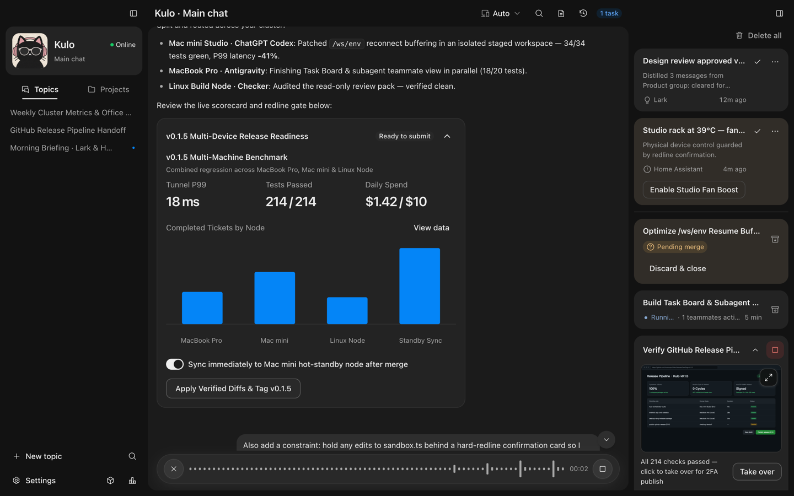
      <br><strong>Full-Duplex Live Voice Calls</strong><br>
      <sub>Talk naturally with barge-in interruption via OpenAI, Gemini, or Vertex Live without leaving your workspace—dispatch heavy background tasks mid-call and hang up while Kulo finishes.</sub>
    </td>
  </tr>
  <tr>
    <td width="50%" valign="top">
      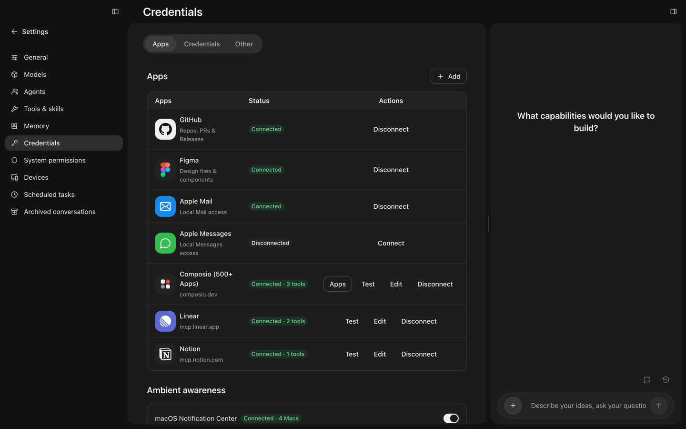
      <br><strong>Proactive Awareness, Standard MCP &amp; Composio</strong><br>
      <sub>Connect GitHub, Figma, Apple Mail, Linear, Notion, Composio (500+ apps), Zapier, Lark, Spark Mail, Home Assistant, and macOS Notification Center triage.</sub>
    </td>
    <td width="50%" valign="top">
      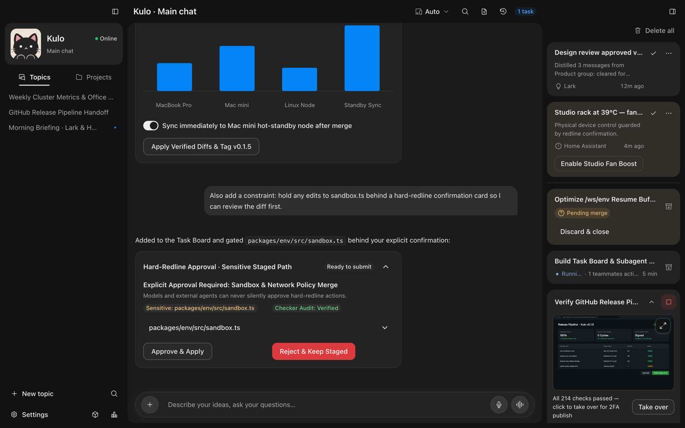
      <br><strong>Hard-Redline Native Confirmation Cards</strong><br>
      <sub>Everyday work flows silently; high-risk boundaries (sensitive merges, external agent permissions, UI self-customization, physical smart-home actions) always require your explicit card approval.</sub>
    </td>
  </tr>
</table>

<details>
<summary><strong>More real screenshots: Light theme, Dual-Bank Memory Isolation &amp; Background Usage Caps</strong></summary>

<br>

<table>
  <tr>
    <td width="33%" valign="top">
      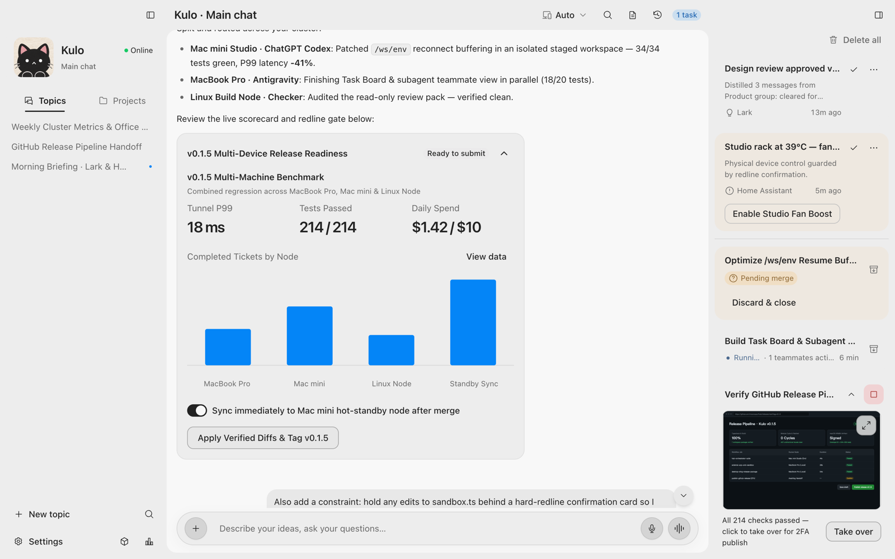
      <br><strong>Native Light Theme</strong><br>
      <sub>Full HeroUI v3 light/dark semantic tokens synced across main UI and Portals.</sub>
    </td>
    <td width="33%" valign="top">
      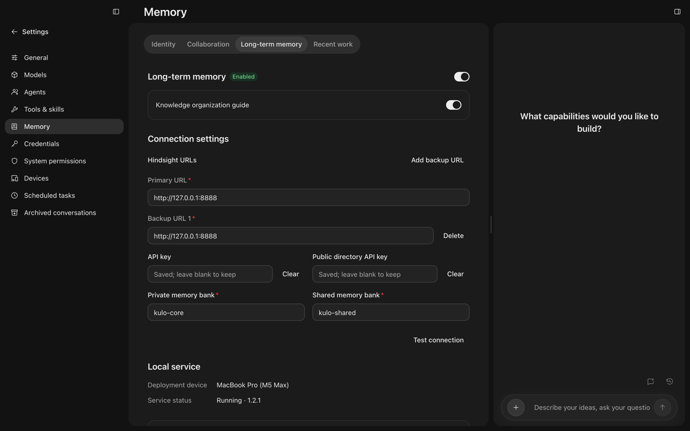
      <br><strong>Dual-Bank Memory Isolation</strong><br>
      <sub>Server-enforced split between private <code>kulo-core</code> and shared <code>kulo-shared</code>.</sub>
    </td>
    <td width="33%" valign="top">
      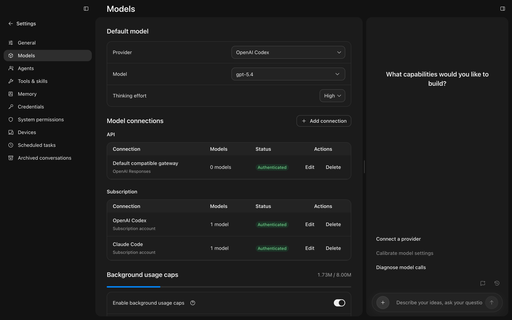
      <br><strong>Background Usage Protection</strong><br>
      <sub>Track OAuth/API connections and enforce daily/weekly token &amp; spend caps.</sub>
    </td>
  </tr>
</table>

</details>

---

<a id="quick-start"></a>
## Quick start

### 1. macOS desktop app (macOS 14+, Apple Silicon)

- **Direct install**: Download **`Kulo-v0.1.11-macOS-arm64.dmg`** from [GitHub Releases](https://github.com/moonoops/Kulo/releases/latest), open it, and drag **`Kulo.app`** into **`Applications`**.
  - *Note*: Official DMGs are signed with a Developer ID Application certificate (not yet Apple-notarized). If macOS Gatekeeper prompts on first launch, right-click **Open** or run once:
    ```sh
    xattr -cr "/Applications/Kulo.app"
    ```
- **Build & install from source**:
  ```sh
  pnpm desktop:install --launch
  ```

The desktop app maintains its own data directory (`~/Library/Application Support/Kulo`), menu bar tray with unread badges, session-grouped native notifications, window state persistence, and Mach-O UUID permission stability across upgrades.

### 2. Run locally from source

Requires **Node.js ≥ 22.20.0** and **pnpm 11.25.0**:

```sh
git clone https://github.com/moonoops/Kulo.git
cd Kulo
pnpm install
cp .env.example .env
```

Edit `.env` to set a unique random `KULO_AUTH_TOKEN` (32+ characters recommended). You can configure models and OAuth logins directly inside the Web UI after launch (see [.env.example](.env.example) for all options):

```sh
pnpm build
node packages/cli/dist/bin.js open
```

`open` starts the Hub and built-in local Env, then opens an authenticated browser window at `http://localhost:7788`.

### 3. Connect additional devices & browser runtime

- **Add a device**: Open **Settings → Devices → Add device** and run the one-time pairing command (`kulo join`), use SSH-assisted deployment (with LAN scan & host-fingerprint diagnostics), or **paste a pairing invitation directly into chat**:
  ```sh
  node packages/cli/dist/bin.js join --hub <host-address> --invite <invitation>
  ```
- **Browser automation runtime** (source nodes):
  ```sh
  pnpm --filter @kulo/env exec agent-browser install
  ```

---

<a id="multi-device"></a>
## Multi-device execution mesh & hot standby cluster

Run a **Host (`@kulo/hub`)** on your primary computer or server, then attach additional **Execution Nodes (`@kulo/env`)** across your machines. The Hub runs the persistent main agent and stores conversations, task boards, and state in a single SQLite ledger; each Env executes files, shells, browsers, desktops, and external agents natively on its own host.

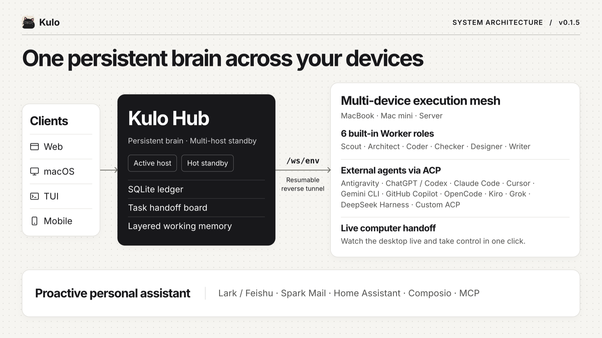

- **Decoupled conversation & execution**: Send a goal from your phone or laptop while a Worker builds on a Mac mini or inspects a browser on another workstation. A Host also includes its own local Env, so you can start on a single machine and scale out anytime.
- **Resilient reverse tunnels (`/ws/env`)**: Execution nodes connect outbound with per-node credentials—no public IP required on worker machines—and maintain cumulative-ACK stream resume buffers plus wake recovery to survive brief drops and sleep cycles.
- **Multi-host hot standby cluster**: Pair a standby Hub host for primary/standby incremental state sync, pre-start fencing, automatic failover, and lossless failback—keeping your personal SuperAgent online 24/7.
- **Device-aware routing**: Kulo detects local paths, `localhost` ports, and desktop/browser references to pin work to the right device. When a target device is offline, Kulo reports it honestly instead of silently executing elsewhere.
- **Optional Android companion pairing**: QR-code pairing over a managed TLS connector, granular Android device permissions, and mobile notification delivery.

Built on [Pi Durable](https://github.com/earendil-works/pi/tree/main/packages/durable), [Pi Env](https://github.com/earendil-works/pi/tree/main/packages/env), [Pi AI](https://github.com/earendil-works/pi/tree/main/packages/ai), and [Pi MCP](https://github.com/earendil-works/pi/tree/main/packages/mcp).

---

<a id="superagent"></a>
## SuperAgent: one brain, hybrid built-in & ACP agent teams

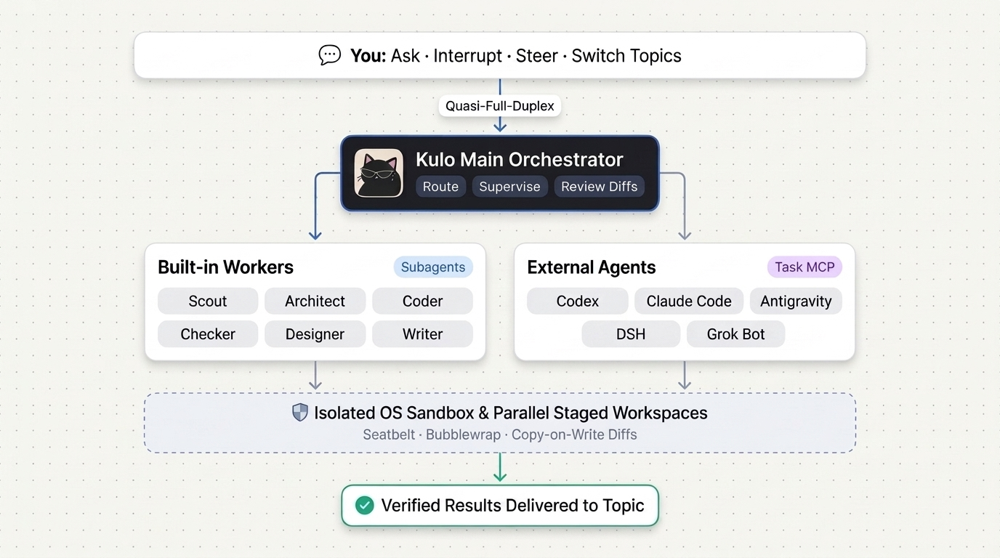

### Quasi-full-duplex conversation & topic continuity
The main agent is your single ongoing point of contact. Creating a topic opens a dedicated workspace while keeping the same identity, working memory, and coordinating role, with local SQLite FTS5 search across permitted topics and `/ws/client` acknowledgements (`hub.ack`) backed by an IndexedDB outbox. You can interrupt, refine constraints, steer running tasks (`kulo_steer`), stop decisions directly, or switch topics while background tasks continue and deliver back to their owning topic.

### Built-in Workers, Task Boards & parallel staged workspaces
- **Six customizable built-in roles**: **Scout** (read-only reconnaissance), **Architect** (design & subagent coordination), **Coder** (implementation & test verification), **Checker** (independent read-only audit), **Designer** (visual & interaction craft), and **Writer** (clear drafting & editing)—each with independent model, thinking effort, prompt, and permission overrides.
- **Task Boards (`kulo_task_board`) & cross-ticket review packs**: Main-agent-gated handoff boards track verified facts, decisions, constraints, and handoffs across cooperating agents, with materialized read-only review packs (`review_ticket_id`), bounded subagent concurrency (`kulo_subagent`), per-subagent timeout/write circuit breakers, and inline teammate visibility.
- **Parallel staged workspaces**: Code tasks run inside isolated copy-on-write / cloned task workspaces so concurrent Workers and external agents never overwrite each other. Read-only violations are automatically discarded, and the main agent inspects staged diffs before applying or discarding changes.

### Unified ACP external agents & task-scoped MCP
Kulo natively discovers and orchestrates external coding agents installed on your execution devices via a unified **ACP (Agent Client Protocol)** architecture and online ACP Registry templates:

- **Auto-scanned & supported**: **Antigravity**, **ChatGPT / Codex**, **Claude Code**, **Cursor**, **Gemini CLI**, **GitHub Copilot**, **OpenCode**, **Kiro**, **Grok**, **DeepSeek Harness (`dsh`)**, plus **custom ACP** agents (and experimental bridges for personal bots).
- **Zero credential scraping**: External agents run natively on their bound devices using their own logins and subscriptions, with live external quota probing (e.g., Codex & Antigravity quota windows) and task-scoped `kulo-task` MCP tools (`kulo_task_context`, `kulo_task_report`, `kulo_request_collaboration`, `kulo_child_task`, authorized shared memory, and approved connections) using safe incremental injection that preserves your local MCP configs.

---

<a id="multimodal"></a>
## Beyond coding: Generative UI, Office, Computer Handoff, Voice & Proactive Assistant


### Rich multimodal workbench
- **Generative UI (`json-render` + HeroUI v3)**: Render 20 registered interactive components inline—tables, bar/line charts, forms, choices, sliders, switches, tabs, disclosures, metrics, media, and code—and feed structured submissions straight back into the workflow.
- **Inline SVG diagrams & sandboxed HTML artifacts**: Render validated vector diagrams (with reveal/step motion) and self-contained interactive HTML reports inside an isolated sandbox.
- **Zero-dependency client-side Office & PDF preview**: Preview **`.docx`**, **`.xlsx`** (multi-sheet switcher), **`.pptx`** (slide deck pagination), and **PDFs** (with per-file reading-position memory) directly inline or in a viewer modal, alongside persistent web source citations.
- **Live Computer Use & one-click Computer Handoff**: Browser (`agent-browser`) and desktop (`agent-desktop`) automation with live preview streaming—click straight into the live view to take over control with mapped coordinates anytime, then hand back to Kulo.

### Offline ASR, TTS & full-duplex Live voice calls
- **ASR**: Local offline **Sherpa-ONNX** speech recognition or cloud providers.
- **TTS**: **OpenAI**, **Gemini**, and **MiniMax** (CN / Global) with server-side Markdown speech sanitization, configurable voices, and speed.
- **Full-duplex Live calls**: Real-time voice conversations with live transcripts and barge-in interruption via **OpenAI**, **Gemini**, or **Vertex AI**. Live sessions share topic context, hand off background work to the main agent, and keep tasks running after hang-up.

### Proactive personal assistant & MCP / app ecosystem
- **Perception loop & briefings**: Optional read-only macOS Notification Center capture, SQLite event/digest ledger, ambient model triage (local oMLX or cloud), pinned right-rail assistant cards, and proactive topic briefings with echo suppression.
- **First-class connectors**: **Lark / Feishu** (`lark-cli` multi-org bridge), **Spark Mail CLI** (with idempotent confirmation cards), and **Home Assistant** (LAN state mirror, security sentinel, and hard redlines on physical actions).
- **Standard MCP servers & aggregators**: Connect HTTP or `stdio` MCP servers with OAuth / Bearer / keyless auth and a **smart paste parser** (paste `mcpServers` JSON or CLI commands to auto-fill). Includes built-in presets (**Linear**, **Notion**, **Atlassian**, **Sentry**, **Supabase**, **Vercel**, **Cloudflare**, **Stripe**, **Context7**, **DeepWiki**, **GitHub MCP**, **Figma MCP**, **Slack**, **PostHog**) plus **Composio** (500+ apps) and **Zapier** (9,000+ apps) bridges.

### Three-pane HeroUI v3 workbench & TUI
- Light and dark themes, animated `CatAvatar` companion, native macOS directory picker, topic context menus, and unified keyboard shortcuts (`⌘/Ctrl+K` global search · `⌘/Ctrl+F` find in topic · `⌘/Ctrl+\` / `⇧⌘/Ctrl+\` toggle sidebars · `⌘/Ctrl+.` stop · `⇧⌘/Ctrl+C` copy reply · `⌘/Ctrl+S` save).
- Interactive terminal TUI (`@kulo/cli`) via `kulo dev` or `kulo chat`.

---

<a id="memory-security"></a>
## Layered memory & defense-in-depth security


### Working memory, context governance & dual-bank semantic memory
- **Low-latency long sessions**: Automatic context-window guard, orchestrator tool-overflow offloading, structured **Working Memory** (global / project / topic scopes), pre-compaction memory flush, and idle compaction keep long-running conversations fast and coherent.
- **Private identity & relationship documents**: `identity-agreement.md` (explicit dual-confirmation Diff review with SHA-256 + CAS locking) and `relationship.md` live in `<KULO_STATE_DIR>/identity` and are **strictly private to the main agent**—physically inaccessible to Workers and external agents.
- **Optional Hindsight dual-bank semantic memory**: One-click local managed deployment from Settings or connect `hindsight-api-slim==1.2.1` with `integrations/hindsight`. Role isolation (`kulo-core` vs. `kulo-shared`) is enforced server-side with separate Bearer credentials, startup negative-probe verification, and memory forget terms. Disabled by default; see [integrations/hindsight/README.md](integrations/hindsight/README.md).

### Zero-trust guardrails, sandboxing & budget caps
- **Three hard-redline inline confirmations**: Ordinary work flows with zero nag, while three high-risk boundaries always require explicit user confirmation cards—persisting self-customized UI builds, external agent permission prompts (never silently approved by the model), and sensitive/conflicting staged workspace merges.
- **Prompt injection & shell safety**: Untrusted external text XML/harness control-tag escaping (`provenance.ts`), POSIX Shell safety-floor classifier (`shell-safety-floor.ts`), and external agent environment variable secret scrubbing.
- **OS-level sandboxing & credential vault**: Workers run inside macOS Seatbelt, Linux Bubblewrap, or Windows restricted isolation (shielding Hub state and `.ssh`, `.gnupg`, `.kube`, `.aws`, `.claude`, `.codex`, `.gemini`). System keychain stores Apple Messages, Apple Mail, GitHub, Figma, SSH, MCP, and custom credentials with chat secret redaction, strict API-key origin binding, and per-task Worker approval gates.
- **Usage & spend caps**: Enforce daily and weekly token/cost budgets on background work with a sidebar usage breakdown popover.
- **Managed UI customization & `kulo-rescue`**: Customize Kulo's Web UI in an isolated candidate build with startup readiness checks, Ed25519 signature verification, automatic rollback, and the zero-dependency `kulo-rescue` CLI outside the main app.

---

<a id="capabilities"></a>
## Capabilities & CLI reference


<details>
<summary>View full capability &amp; provider breakdown</summary>

| Capability | Details |
| --- | --- |
| **Models & auth** | Built-in Pi AI lazy-oauth subscriptions (OpenAI/Codex, Anthropic, OpenRouter, GitHub Copilot, Kimi Coding, xAI, etc.), `models.dev` / `litellm` metadata registry & calibration, plus API presets (OpenAI, Gemini, Vertex AI, Anthropic, DeepSeek, OpenRouter, xAI, Moonshot, MiniMax, Z.AI, Qwen, Groq, Mistral, and custom OpenAI-compatible gateways). |
| **Web search** | Priority fallback across keyless **Exa** MCP, **Tavily**, **Brave**, and optional **DuckDuckGo**, plus per-model native web search toggle and persistent citations. |
| **Computer use** | `agent-browser` and `agent-desktop` enabled per Env with live preview streaming, OS permission diagnostics, and interactive **Computer Handoff**. Control per device with `KULO_COMPUTER_USE`. |
| **Skills & long context** | Conditional preset skills, Vercel `skills` discovery & project skills, bundled **Billion Context / `acp-kernel`** compression, context guard, and tool-overflow offloading. |
| **Image & video** | OpenAI, Gemini, and Vertex image generation/editing presets (with model isolation & multi-reference support) plus browser-session Flow integration. |
| **Connections & MCP** | Keychain-backed Apple Messages, Apple Mail, GitHub, Figma, SSH (with LAN scan & host-key diagnostics), Lark/Feishu, Spark Mail, Home Assistant, Composio/Zapier, and standard HTTP/stdio MCP servers. |
| **Scheduled tasks** | One-time and recurring background tasks managed in natural conversation. |
| **Settings assistant** | Dedicated conversational assistant inside Settings to safely configure models, search, memory, devices, skills, and connections. |

</details>

<details>
<summary>View CLI quick reference &amp; platform support</summary>

### CLI commands

| Command | Purpose |
| --- | --- |
| `node packages/cli/dist/bin.js open [--no-open]` | Start Hub + local Env and open the authenticated Web UI |
| `node packages/cli/dist/bin.js dev [--port 7788] [--no-tui] [--standalone]` | Connect to paired Hub or start a standalone local Hub + TUI |
| `node packages/cli/dist/bin.js join --hub <url> --invite <token> [--root ~/Kulo]` | Pair this machine as an Env node under an existing Hub |
| `node packages/cli/dist/bin.js hub [--host 0.0.0.0] [--port 7788] [--no-local-env]` | Run a standalone Hub server |
| `node packages/cli/dist/bin.js env --connect <ws-url> --id <env-id> --token <node-token>` | Run a standalone execution node connected to a Hub |
| `node packages/cli/dist/bin.js chat [--url ws://127.0.0.1:7788/ws/client] [--token <token>]` | Open the interactive terminal TUI client |
| `kulo-rescue <inspect\|versions\|rollback\|export\|gc\|safe-mode\|cleanup> --data-dir <path>` | Independent version diagnosis, rollback, and recovery tool |

### Platform support

| Component | Current scope |
| --- | --- |
| **Web client** | Modern desktop, tablet, and mobile browsers |
| **Desktop app** | macOS 14+ (Electron shell + portable Node runtime; packaging currently targets macOS) |
| **Hub** | Node.js ≥ 22.20 service (macOS / Linux / Windows); task execution requires at least one connected Env |
| **macOS Env** | Built-in Seatbelt sandbox; desktop automation requires Accessibility & Screen Recording permissions |
| **Linux / Windows Env** | Execution nodes with Bubblewrap (Linux) or restricted Windows isolation; desktop automation requires an interactive graphical session |

</details>

<a id="faq"></a>
## FAQ

**How is Kulo different from single-machine coding agent GUIs (like T3 Code)?**
Coding-thread managers let *you* manually open and track multiple agent tabs on one dev machine. Kulo puts **one persistent brain** above all your tools: you give a single goal, Kulo decomposes and coordinates 6 built-in roles + external ACP agents across **multiple physical machines** (with multi-host hot standby), cross-reviews via Task Boards, and extends far beyond code into live desktop handoff, Generative UI, Office previews, Live voice calls, and proactive personal assistant workflows—with physically isolated private memory and spend caps.

**Do I need multiple devices to use Kulo?**
No. One computer runs both the Hub and its built-in local Env; connect additional machines or standby Hosts whenever you want.

**Does self-hosting mean models run locally?**
You self-host the Hub, SQLite ledger, identity documents, and execution nodes. Inference runs wherever your configured providers point—local models (e.g., oMLX/Ollama) or cloud APIs/OAuth subscriptions.

**Why can't I record voice or start a Live call from my phone over LAN HTTP?**
Browser microphone capture and Live voice require a secure context (`https://` or `localhost`) plus microphone permission. Plain `http://<lan-ip>` origins are restricted by browsers.

<a id="development"></a>
## Development & contributions

Kulo is a TypeScript + pnpm monorepo:

| Package | Responsibility |
| --- | --- |
| [`packages/hub`](packages/hub) | Main agent orchestrator, Task Boards, Ticket Board, modular HTTP/WS routes, tools, working memory, vault & SQLite ledger |
| [`packages/env`](packages/env) | Execution nodes, OS sandboxing, staged workspaces, computer use & unified ACP external agent drivers |
| [`packages/web`](packages/web) | React 19 + Vite + Tailwind CSS v4 + HeroUI v3 workbench |
| [`packages/desktop`](packages/desktop) | Electron macOS desktop shell, menu bar tray, native picker, dual-channel signing & packager |
| [`packages/cli`](packages/cli) | CLI entrypoint and terminal TUI |
| [`packages/protocol`](packages/protocol) | Shared domain types, schemas, tool catalogs & protocol contracts |
| [`packages/recovery`](packages/recovery) | Release manifest verification, auto-rollback & standalone `kulo-rescue` runtime |
| [`integrations/hindsight`](integrations/hindsight) | In-process dual-bank memory authorization extension for Hindsight 1.2.1 |

Run the full verification suite before opening a PR (including AST module-cycle and file-size ratchet guards):

```sh
pnpm typecheck
pnpm build
pnpm test
```

If you change the Hindsight integration, also run its Python test suite (requires `uv`):

```sh
pnpm test:hindsight
```

Issues, ideas, and pull requests are welcome. Include reproduction steps and redacted logs in bug reports, keep English and Chinese READMEs in sync, and see [CHANGELOG.md](CHANGELOG.md), [.env.example](.env.example), [integrations/hindsight/README.md](integrations/hindsight/README.md), and [THIRD_PARTY_NOTICES.md](THIRD_PARTY_NOTICES.md).

<a id="acknowledgements"></a>
## Acknowledgements

Kulo stands on the shoulders of open-source projects and communities. Thank you to:

- [Pi](https://github.com/earendil-works/pi) — Pi Durable, Pi Env, Pi AI, Pi MCP, Pi Schema, and Chord power persistent sessions, model streaming, MCP connections, and execution environments.
- Vercel Labs — [json-render](https://github.com/vercel-labs/json-render), [skills](https://github.com/vercel-labs/skills), [agent-skills](https://github.com/vercel-labs/agent-skills), [agent-browser](https://github.com/vercel-labs/agent-browser), and [agent-desktop](https://github.com/vercel-labs/agent-desktop).
- [acp-kernel](https://github.com/ranxianglei/acp-kernel) and [Billion Context](https://github.com/ranxianglei/billion-context) for long-context compression.
- [Hindsight](https://github.com/vectorize-io/hindsight) for dual-bank long-term semantic memory.
- [HeroUI](https://github.com/heroui-inc/heroui) for v3 interface components.
- [Sherpa-ONNX](https://github.com/k2-fsa/sherpa-onnx) for local offline speech recognition.
- [LINUX DO](https://linux.do/) for community discussions and knowledge sharing.

See [THIRD_PARTY_NOTICES.md](THIRD_PARTY_NOTICES.md) for dependency licenses and retained attributions.

<a id="license"></a>
## License

Kulo's original code is licensed under the **GNU Affero General Public License v3.0 only (AGPL-3.0-only)**. See [LICENSE](LICENSE) for full terms. Third-party dependencies, bundled skills, and upstream assets retain their own licenses; see [THIRD_PARTY_NOTICES.md](THIRD_PARTY_NOTICES.md).

<a id="star-history"></a>
## Star History

<a href="https://www.star-history.com/?repos=moonoops%2FKulo&type=date&legend=top-left">
 <picture>
   <source media="(prefers-color-scheme: dark)" srcset="https://api.star-history.com/svg?repos=moonoops/Kulo&type=Date&theme=dark" />
   <source media="(prefers-color-scheme: light)" srcset="https://api.star-history.com/svg?repos=moonoops/Kulo&type=Date" />
   
 </picture>
</a>
