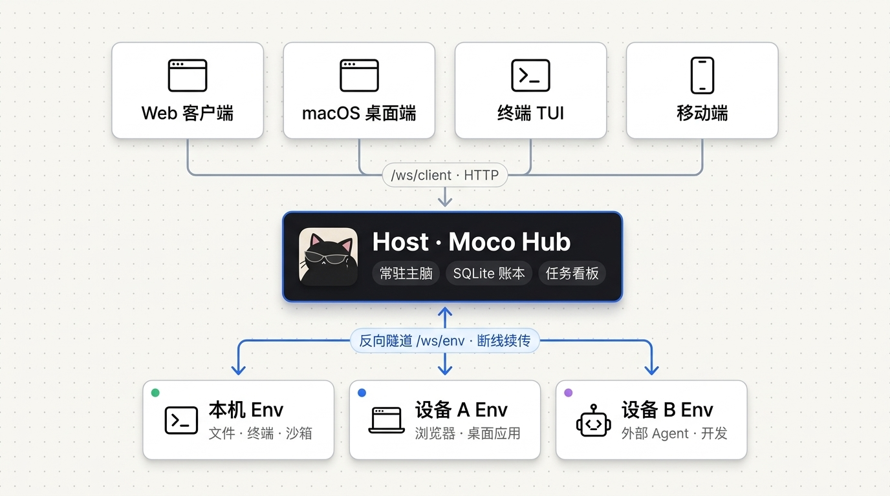
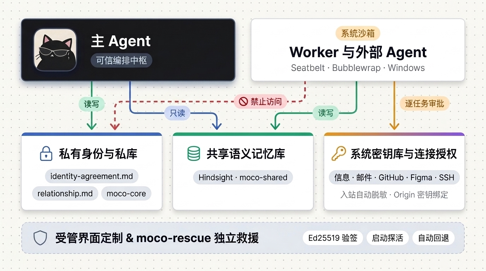
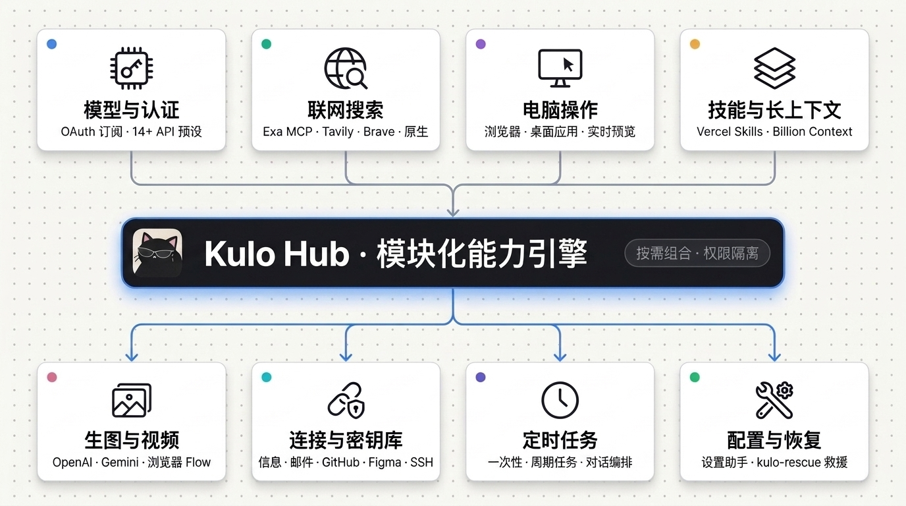

<p align="center">
  
</p>

<h1 align="center">Moco</h1>

<p align="center"><strong>你的跨设备常驻个人 SuperAgent</strong></p>

<p align="center">
  <a href="README.md">English</a> | 简体中文
</p>

<p align="center">
  <a href="https://github.com/moonoops/moco/releases"></a>
  <a href="https://github.com/moonoops/moco/stargazers"></a>
  <a href="LICENSE"></a>
  
  = 22.20">
</p>

Moco 是一套可自托管的跨设备常驻个人智能体。你始终与同一个 Moco 对话：它维系你的专属身份约定与协作关系，在隔离工作区中协同多台设备上的内置 Worker 与本地外部 Agent，并把经核查的结果带回同一个入口——将文字、语音、实时通话、生成式界面与后台并行执行融为一体。

[多设备协作](#multi-device) · [SuperAgent 与 Worker](#superagent) · [多模态与语音](#multimodal) · [记忆与安全](#memory-security) · [能力一览](#capabilities) · [快速开始](#quick-start) · [开发与贡献](#development)

<a id="multi-device"></a>
## 一套 Moco，贯通你的多台设备

在电脑或服务器上运行一台 **Host（`@moco/hub`）**，再按需接入其他设备的 **执行节点（`@moco/env`）**。Hub 承载常驻主 Agent、单一 SQLite 账本与任务看板；每个 Env 提供受系统隔离的真实执行环境，让文件读写、命令执行、浏览器/桌面操作和外部 Agent 原地运行。



- **对话与执行解耦**：在手机或轻薄本上提出需求，由工作站上的 Worker 改代码或另一台电脑操作浏览器。Host 自带本机 Env，单机即可起步，随时扩展更多设备。
- **可续传的反向隧道（`/ws/env`）**：执行节点使用独立节点凭据主动连向 Hub，无需公网 IP；内置累积确认流续传缓冲（Stream Resume），网络短暂抖动时无缝续传不丢输出。
- **三种便捷配对方式**：支持一次性配对命令（`moco join`）、SSH 辅助自动部署，以及**直接在对话里粘贴配对邀请完成接入或重新绑定**。
- **设备亲和路由**：自动识别本地路径、`localhost` 端口、桌面/浏览器等本机信号并绑定目标设备；目标设备离线时如实汇报，不会暗中改派到其他机器。
- **可选 Android 手机配对**：支持受管 TLS 连接器扫码配对、细粒度 Android 权限授权与通知投递。

底层基于 [Pi Durable](https://github.com/earendil-works/pi/tree/main/packages/durable)（持久会话）、[Pi Env](https://github.com/earendil-works/pi/tree/main/packages/env)（执行环境）与 [Pi AI](https://github.com/earendil-works/pi/tree/main/packages/ai)（统一模型流与 OAuth 认证）构建。

<a id="superagent"></a>
## SuperAgent：同一个主脑，背后是一支并行协作团队

### 不同话题，始终是同一个 Moco

主 Agent 是你唯一的固定协作入口。新建话题只是切换讨论空间：身份、协作习惯与协调职责保持连续，各话题消息与任务上下文相互独立，同时支持通过本地 SQLite FTS5 全文索引按权限跨话题检索历史。客户端通信基于 `/ws/client` 请求回执（`hub.ack`）与 IndexedDB 离线重发队列保障消息可靠送达。

### 准全双工交互：随时插话、追单引导、自由切话题

在主 Agent 思考、流式回复或跟进后台任务期间，你可以随时发送新消息——补充约束、纠正方向、追问进度或直接切到别的话题。新消息会在下一个处理节点被吸收，并可通过追单引导（`moco_steer`）调整运行中的任务。切换话题不会中断已派发的后台任务，结果完成后自动回到对应话题。

### 内置 Worker、子代理与并行暂存工作区


- **六大可定制内置角色**：**侦察员（Scout，只读摸底）**、**架构师（Architect，方案与子代理统筹）**、**开发者（Coder，实现与测试验证）**、**检验员（Checker，独立只读审查）**、**设计师（Designer，视觉与交互）**、**写作者（Writer，文档与内容）**。各角色支持独立配置模型、思考强度、提示词与权限边界。
- **实时任务看板与子代理**：有界并发 Worker 调度、增量看板同步、重试/停止/阻塞提问回传，并支持按工单派生子代理（`moco_subagent`）处理复杂拆分任务。
- **并行暂存工作区（Staged Workspaces）**：编码任务可在独立的写时复制（CoW）/ 克隆暂存目录中并行运行，多个 Worker 同时改动同一仓库互不覆盖；只读角色的越权改动会被自动丢弃，主脑审阅 Diff 后再决定应用或放弃。
- **分层动态工具面**：按受众（对话、设置助手、电脑 Worker、Android Worker）将工具划分为常驻、事件触发与按需延迟加载三层，既保持上下文精简，又严格收敛权限面。

### 原生外部 Agent 与任务级 MCP 协同

Moco 可直接调度执行设备上已安装的本地外部 Agent：

- **正式支持**：**Codex**（App Server）、**Claude Code**（原生 SDK/CLI）、**Antigravity**（`agy acp`）、**DeepSeek Harness**（`dsh --profile acp`）。
- **实验性支持**：**Grok Bot** 本地桥接（另预留 ChatGPT Dots 与 Meta Muse 接入指南）。

外部 Agent 在绑定设备上沿用自身的原生账号、工具和权限设置——Moco 从不在对话中索取其登录凭据——同时通过任务级 Moco MCP 工具获得上下文读取、结果汇报、协作请求、子任务派发、授权共享记忆与经审批的连接能力。

<a id="multimodal"></a>
## 多模态、生成式 UI、语音与多端工作台


### 多模态对话与生成式 UI

支持文字、图片、音频、视频与任意文件输入；内置多媒体预览、带阅读进度记忆的 PDF 预览器、代码高亮块、引用回复、对话大纲与归档库，以及跨轮持久化保留的联网来源引用。

- **生成式 UI（`json-render` + HeroUI v3）**：Agent 可在对话中直接渲染 20 种受控交互组件——包括表格、柱状图/折线图、表单、单选/多选、滑块、开关、复选框、标签页、折叠面板、指标卡、媒体与代码块——你的选择或表单提交会以结构化数据回传给 Agent 继续推进任务。
- **沙箱 HTML 产物预览**：面向更自由的交互页面或数据报告，Moco 支持在隔离沙箱中安全呈现 HTML 交付物。

### 离线语音识别、朗读与全双工 Live 通话

- **语音输入（ASR）**：支持本地离线 **Sherpa-ONNX** 语音识别或云端模型供应商。
- **语音播报（TTS）**：支持 **OpenAI**、**Gemini** 与 **MiniMax**（国内/国际版），可调音色与语速。
- **全双工 Live 实时通话**：支持接入 **OpenAI**、**Gemini** 与 **Vertex AI** Live 服务，提供实时语音、双语字幕、随时打断，并共享当前话题上下文；通话中可直接把复杂任务交给主脑后台执行，挂断后任务继续推进。

### Web、macOS 桌面端与终端工作台

- **HeroUI v3 三栏工作台（`@moco/web`、`@moco/desktop`）**：内置浅色 / 深色双主题、可定制的动态猫咪陪伴形象（`CatAvatar`），并提供统一的桌面端与 Web 键盘快捷键：
  - `⌘/Ctrl+K` 搜索全部对话 · `⌘/Ctrl+F` 当前对话内查找 · `⌘/Ctrl+\` / `⇧⌘/Ctrl+\` 切换左右侧栏 · `⌘/Ctrl+.` 停止生成 · `⇧⌘/Ctrl+C` 复制最新回复 · `⌘/Ctrl+S` 保存更改；桌面端原生菜单另含 `⌘/Ctrl+N` 新建话题、`⌘/Ctrl+,` 设置、`⌘/Ctrl+1` 回到主对话。
- **终端准全双工 TUI（`@moco/cli`）**：可通过 `moco dev` 或 `moco chat` 直接在终端交互。

<a id="memory-security"></a>
## 有边界的记忆体系与纵深安全隔离



### 私有身份与协作关系文档

Moco 在 `<MOCO_STATE_DIR>/identity` 维护两份私有文档：`identity-agreement.md`（修改需经显式双签 Diff 审阅、SHA-256 + 目录版本 CAS 锁校验并保留可回滚备份）与 `relationship.md`（支持手动编辑与空闲自主整理）。两份文档**仅对主 Agent 可见**，对后台 Worker 与外部 Agent 物理屏蔽。

### 可选 Hindsight 双 Bank 语义记忆

需要跨会话长期语义记忆时，可在设置中**一键托管部署本地 Hindsight**，或连接已加载 `integrations/hindsight` 授权扩展的 `hindsight-api-slim==1.2.1` 服务。`moco-core` 私有库与 `moco-shared` 共享库的权限边界在 Hindsight 进程内通过独立 Bearer 密钥（`MOCO_HINDSIGHT_ROUTER_API_KEY` 与 `MOCO_HINDSIGHT_WORKER_API_KEY`）强制执行，并在启动探活时做负向越权验证。Hindsight 默认关闭，部署与安全规约见 [integrations/hindsight/README.md](integrations/hindsight/README.md)。

### 系统密钥库、系统沙箱与受管恢复

- **系统密钥库与连接授权**：利用系统密钥库（macOS Keychain / Linux Secret Service / Windows Credential Manager）加密管理预置应用（**Apple 信息**、**Apple 邮件**、**GitHub**、**Figma**）、**SSH** 与自定义凭据。对话中粘贴的敏感信息会自动识别脱敏再入库；Worker 调用连接前须经逐任务显式授权。
- **模型凭据隔离**：OAuth 订阅认证与自定义 API Key 位于相互隔离的 Provider ID 下，互不覆盖；已保存的 API Key 严格绑定原服务 origin，绝不会转发至修改后的第三方地址。
- **OS 级 Worker 沙箱**：内置 Worker 在 macOS Seatbelt、Linux Bubblewrap 或 Windows 受限隔离环境中运行，物理屏蔽 Hub 状态目录与敏感用户目录（`.ssh`、`.gnupg`、`.kube`、`.aws`、`.claude`、`.codex`、`.gemini`）。
- **受管界面定制与 `moco-rescue` 独立救援**：macOS 桌面端支持在隔离候选环境中定制 Web 界面、执行启动健康检查、Ed25519 官方更新验签，并在启动异常时自动回退至上一个稳定版本；主程序之外保留零业务依赖的 `moco-rescue` 命令行工具用于诊断、回滚、安全模式恢复、残留清理与脱敏日志导出。

<a id="capabilities"></a>
## 能力一览



<details>
<summary>展开查看完整能力与供应商明细</summary>

| 能力模块 | 说明 |
| --- | --- |
| **模型与认证** | 支持 Pi AI 内置 OAuth 订阅登录（OpenAI/Codex、Anthropic、OpenRouter、GitHub Copilot、Kimi Coding、xAI 等）与主流 API 预设（OpenAI、Gemini、Vertex AI、Anthropic、DeepSeek、OpenRouter、xAI、Moonshot、MiniMax、智谱 Z.AI、通义千问、Groq、Mistral 及任意 OpenAI 兼容网关）。 |
| **联网搜索** | 多方案优先级回退：免 Key **Exa** MCP 预设、**Tavily**、**Brave** 与可选 **DuckDuckGo**，并支持按模型单独开关原生联网工具与跨轮保留引用来源。 |
| **电脑操作** | 按执行设备默认启用 `agent-browser` 与 `agent-desktop`，支持实时画面预览与系统权限诊断；可通过 `MOCO_COMPUTER_USE` 按设备独立开关。 |
| **技能与扩展** | 内置按条件激活的预设技能（浏览器/桌面自动化、React 与 Web 设计规范、生成式卡片、能力配置等）、Vercel `skills` 发现安装与项目级技能，另可选 **Billion Context / `acp-kernel`** 长上下文压缩扩展。 |
| **生图与视频** | 内置 OpenAI 与 Gemini 生图/改图预设（支持多图参考），并支持衔接浏览器 Flow 会话执行多媒体生成任务。 |
| **连接与密钥库** | 基于系统密钥库的 Apple 信息、Apple 邮件、GitHub、Figma、SSH 与自定义凭据，配合入站脱敏与任务级审批。 |
| **定时任务** | 通过自然语言安排一次性或周期性后台任务。 |
| **设置助手** | 设置页内置对话式配置助手，安全引导完成模型、搜索、Hindsight、设备、技能与连接配置。 |

</details>

<a id="quick-start"></a>
## 快速开始

### 1. 从源码在本地运行

需要 **Node.js ≥ 22.20.0** 与 **pnpm 11.25.0**：

```sh
git clone https://github.com/moonoops/moco.git
cd moco
pnpm install
cp .env.example .env
```

编辑 `.env`，为 `MOCO_AUTH_TOKEN` 设置独立的随机密钥（建议至少 32 位）；将 `MOCO_BASE_URL`、`MOCO_API_KEY`、`MOCO_MODEL` 替换为自己的配置，或清空后启动应用并在 Web 设置页完成 API / OAuth 配置。全部环境变量见 [.env.example](.env.example)。

```sh
pnpm build
node packages/cli/dist/bin.js open
```

`open` 会启动 Hub 与内置本机 Env，并自动打开已携带认证信息的浏览器页面（默认 `http://localhost:7788`）。

### 2. macOS 桌面应用（macOS 14+）

- **直接安装（Apple Silicon）**：前往 [GitHub Releases](https://github.com/moonoops/moco/releases/latest) 下载 **`Moco-v0.1.1-macOS-arm64.dmg`**，双击挂载后将 **`Moco Dev.app`** 拖入 **`Applications`** 即可。当前版本采用本地 ad-hoc 签名，如首次打开遇到 macOS 安全提示，执行一次 `xattr -cr "/Applications/Moco Dev.app"` 后重新打开即可。
- **从源码构建安装**：为当前机器架构构建并安装独立桌面版：

```sh
pnpm desktop:install --launch
```

桌面版使用独立的数据目录与设置，不读取源码目录的 `.env`。日常开发可使用 `pnpm desktop:dev`（桌面端）或 `pnpm dev`（终端 TUI）。

### 3. 接入更多设备与浏览器运行环境

- **添加设备**：打开「设置 → 设备互联 → 添加设备」，在目标设备执行生成的一次性配对命令、使用 SSH 辅助部署，或直接把配对邀请粘贴进对话。已有源码构建的设备也可运行：
  ```sh
  node packages/cli/dist/bin.js join --hub <主脑地址> --invite <配对凭证>
  ```
- **浏览器自动化依赖**：网页操作需要 Chrome 或 Chromium；源码部署的执行节点可运行以下命令安装专用浏览器：
  ```sh
  pnpm --filter @moco/env exec agent-browser install
  ```

### CLI 常用命令

| 命令 | 说明 |
| --- | --- |
| `node packages/cli/dist/bin.js open [--no-open]` | 启动 Hub + 本机 Env 并打开认证后的 Web 控制台 |
| `node packages/cli/dist/bin.js dev [--port 7788] [--no-tui] [--standalone]` | 连接已配对主脑，或单机启动本地 Hub 与终端 TUI |
| `node packages/cli/dist/bin.js join --hub <地址> --invite <凭证> [--root ~/Moco]` | 作为执行节点配对加入已有主脑 |
| `node packages/cli/dist/bin.js hub [--host 0.0.0.0] [--port 7788] [--no-local-env]` | 独立启动常驻 Hub 服务 |
| `node packages/cli/dist/bin.js env --connect <ws地址> --id <env-id> --token <节点凭据>` | 独立启动执行节点并反向注册至 Hub |
| `node packages/cli/dist/bin.js chat [--url ws://127.0.0.1:7788/ws/client] [--token <token>]` | 打开终端准全双工 TUI 客户端 |
| `moco-rescue <inspect\|versions\|rollback\|export\|gc\|safe-mode\|cleanup> --data-dir <路径>` | 独立版本诊断、回滚、安全基线恢复与清理工具 |

<a id="platforms"></a>
## 平台支持

| 组件 | 当前支持范围 |
| --- | --- |
| **Web 客户端** | 电脑、平板与手机上的现代浏览器 |
| **桌面应用** | macOS 14+（Electron 外壳 + 独立便携 Node 运行时；当前打包脚本面向 macOS） |
| **Hub** | Node.js ≥ 22.20 服务（macOS / Linux / Windows）；执行任务需至少连接一个 Env |
| **macOS Env** | 内置 Seatbelt 沙箱；桌面自动化需授予辅助功能与屏幕录制权限 |
| **Linux / Windows Env** | 需对应平台隔离后端（Bubblewrap / Windows 受限隔离）；桌面操作需交互式图形会话 |

<a id="faq"></a>
## 常见问题

**必须有多台设备才能使用 Moco 吗？**
不需要。单台电脑即可同时运行 Hub 与内置本机 Env，后续随时接入更多设备。

**自托管是否意味着模型必须在本地运行？**
你托管的是 Hub、SQLite 状态、身份文档与执行节点；模型推理位置取决于你的配置，可使用本地模型，也可对接云端 API 或 OAuth 订阅。

**为什么手机通过局域网 HTTP 打开后无法录音或发起 Live 通话？**
浏览器麦克风采集与实时语音依赖安全上下文（`https://` 或 `localhost`）及麦克风权限，普通 `http://<局域网IP>` 会被浏览器限制。

<a id="development"></a>
## 开发与贡献

仓库采用 TypeScript + pnpm monorepo 结构：

| 模块 | 职责 |
| --- | --- |
| [`packages/hub`](packages/hub) | 主脑编排器、任务看板、HTTP/WS 服务、工具体系、记忆、密钥库与 SQLite 账本 |
| [`packages/env`](packages/env) | 执行节点、OS 沙箱、暂存工作区、电脑操作与外部 Agent 驱动 |
| [`packages/web`](packages/web) | React 19 + Vite + Tailwind CSS v4 + HeroUI v3 工作台 |
| [`packages/desktop`](packages/desktop) | Electron macOS 桌面外壳、原生菜单、快捷键与打包脚本 |
| [`packages/cli`](packages/cli) | 命令行入口与终端 TUI |
| [`packages/protocol`](packages/protocol) | 共享领域类型、Schema、工具目录与通信协议 |
| [`packages/recovery`](packages/recovery) | 制品清单验签、自动回退与独立 `moco-rescue` 运行时 |
| [`integrations/hindsight`](integrations/hindsight) | Hindsight 1.2.1 进程内双 Bank 记忆授权扩展 |

提交 PR 前请运行全量检查：

```sh
pnpm typecheck
pnpm build
pnpm test
```

修改 Hindsight 集成时，请同时运行 Python 测试套件（需要 `uv`）：

```sh
pnpm test:hindsight
```

欢迎提交 Issue、建议和 Pull Request。问题反馈请附复现步骤与脱敏日志，修改功能时请保持中英文 README 同步。更多细节见 [CHANGELOG.md](CHANGELOG.md)、[.env.example](.env.example)、[integrations/hindsight/README.md](integrations/hindsight/README.md) 与 [THIRD_PARTY_NOTICES.md](THIRD_PARTY_NOTICES.md)。

<a id="acknowledgements"></a>
## 致谢

Moco 建立在众多优秀开源项目与社区分享之上，特别感谢：

- [Pi](https://github.com/earendil-works/pi) — Pi Durable、Pi Env、Pi AI、Pi Schema 与 Chord 提供持久会话、模型接入与执行环境基础。
- Vercel Labs — [json-render](https://github.com/vercel-labs/json-render)、[skills](https://github.com/vercel-labs/skills)、[agent-skills](https://github.com/vercel-labs/agent-skills)、[agent-browser](https://github.com/vercel-labs/agent-browser) 与 [agent-desktop](https://github.com/vercel-labs/agent-desktop)。
- [acp-kernel](https://github.com/ranxianglei/acp-kernel) 与 [Billion Context](https://github.com/ranxianglei/billion-context) 提供可选长上下文压缩扩展。
- [Hindsight](https://github.com/vectorize-io/hindsight) 提供双 Bank 长期语义记忆能力。
- [HeroUI](https://github.com/heroui-inc/heroui) 提供 v3 界面组件库。
- [Sherpa-ONNX](https://github.com/k2-fsa/sherpa-onnx) 提供本地离线语音识别能力。
- [LINUX DO](https://linux.do/) 社区的交流与知识分享。

完整依赖许可与保留归属见 [THIRD_PARTY_NOTICES.md](THIRD_PARTY_NOTICES.md)。

<a id="license"></a>
## 开源协议

Moco 原创代码采用 **GNU Affero General Public License v3.0 only（AGPL-3.0-only）**，完整条款见 [LICENSE](LICENSE)。第三方依赖、随附技能与其他上游材料保留各自许可，见 [THIRD_PARTY_NOTICES.md](THIRD_PARTY_NOTICES.md)。

<a id="star-history"></a>
## Star History

<a href="https://www.star-history.com/?repos=moonoops%2Fmoco&type=date&legend=top-left">
 <picture>
   <source media="(prefers-color-scheme: dark)" srcset="https://api.star-history.com/svg?repos=moonoops/moco&type=Date&theme=dark" />
   <source media="(prefers-color-scheme: light)" srcset="https://api.star-history.com/svg?repos=moonoops/moco&type=Date" />
   
 </picture>
</a>
