<p align="center">
  
</p>

<h1 align="center">Kulo</h1>

<p align="center"><strong>跨设备常驻的个人多智能体指挥中枢（Personal SuperAgent）</strong></p>

<p align="center">
  <a href="README.md">English</a> | 简体中文
</p>

<p align="center">
  <a href="https://github.com/moonoops/Kulo/releases"></a>
  <a href="https://github.com/moonoops/Kulo/stargazers"></a>
  <a href="LICENSE"></a>
  
  
  = 22.20">
</p>

<p align="center">
  <a href="#why-kulo">为什么做 Kulo</a> ·
  <a href="#showcase">实机界面一览</a> ·
  <a href="#quick-start">快速开始</a> ·
  <a href="#multi-device">多机集群与热备</a> ·
  <a href="#superagent">外部 ACP 混编</a> ·
  <a href="#multimodal">语音 / 接管 / 主动助理</a> ·
  <a href="#memory-security">安全与预算</a> ·
  <a href="#capabilities">能力与 CLI</a>
</p>

<p align="center">
  <picture>
    <source media="(prefers-color-scheme: dark)" srcset="assets/readme/hero-dark-zh.png">
    <source media="(prefers-color-scheme: light)" srcset="assets/readme/hero-light-zh.png">
    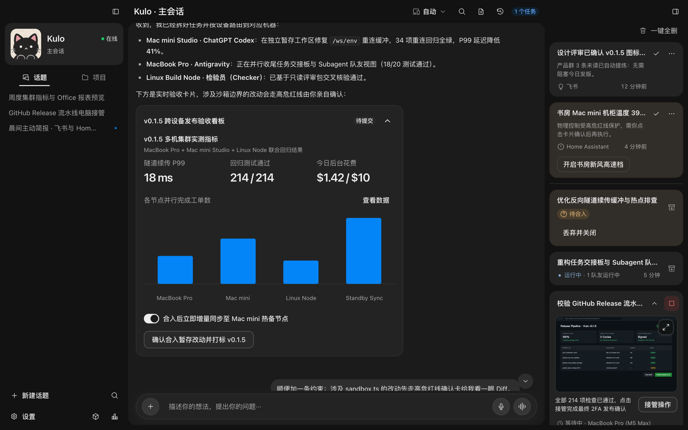
  </picture>
  <br>
  <sub><em>Kulo v0.1.5 真实工作台截图（自动跟随 GitHub 深浅主题切换）：左侧常驻主脑与多话题、中间实时生成式 UI 验收看板、右侧飞书 / Home Assistant 主动感知卡片、并行工单与实时电脑接管画面。</em></sub>
</p>

---

<a id="why-kulo"></a>
## 为什么做 Kulo？

现在很多人的桌面同时开着 **Antigravity**、**ChatGPT / Codex**、**Claude Code**、**Cursor**、**Gemini CLI**，手里还有笔记本、Mac mini、Linux 服务器和手机。AI 工具越来越多，结果**你自己成了在十个窗口之间来回复制上下文的项目经理**。

**Kulo 是一套开源自托管的 Personal Agent（个人智能体）**，目标不是再做一个多开标签页，而是在你所有设备和工具之上，立起**一个真正属于你的常驻主脑**：

- **不同话题、不同设备，始终是同一个 Kulo**：无论在 Mac 桌面端、网页、终端 TUI 还是手机上，你始终只跟同一个主脑对话。它带着连续的身份约定和分层工作记忆；在它思考或后台干活时，你可以随时插话改方向，或直接切到别的话题，后台任务照常推进并把结果送回原话题。
- **把你已有的所有 Agent 编进一支团队**：内置六大可定制专家角色（**侦察员、架构师、开发者、检验员、设计师、写作者**），同时通过统一 ACP 协议自动连接你各台电脑上已装好的 **10+ 外部智能体**，沿用原生账号和订阅，还能实时查看外部剩余额度。
- **真正的多机运行集群 + 主备热备**：用可续传反向隧道（`/ws/env`）把 MacBook、Mac mini 和 Linux 服务器连成一张执行网格——执行节点无需公网 IP，自动按路径/端口路由，还能配一台备用主机实现故障自动接管与无损回切。
- **远远不止于写代码**：支持随时打断的 **全双工 Live 实时语音通话**（边走边派活，挂断后台继续跑）、**20 种生成式 UI 交互卡片**、内联矢量图示、零依赖 **Word / 多 Sheet Excel / PPT / PDF** 在线预览、右侧实时推流与一键 **电脑接管（Computer Handoff）**、**24 小时主动个人助理**（飞书、Spark 邮件、Home Assistant 智能家居），以及标准 **MCP + Composio / Zapier** 生态。
- **敢 24 小时常驻，靠的是架构层硬边界**：个人身份文档与 `kulo-core` 私密记忆对后台 Worker 与外部 Agent 物理不可见；执行层跑在 **Seatbelt / Bubblewrap** 系统沙箱里；日常零打扰，仅在**三条高危红线**处弹出原生确认卡；支持**每日/每周后台用量预算封顶**。

### Kulo 与传统对话工具、单机 Coding 多开面板的区别

| 维度 | 普通 AI 对话客户端 | 单机 Coding 线程面板（如 T3 Code） | **Kulo（跨设备 Personal Agent）** |
| --- | --- | --- | --- |
| **交互范式** | 1 对 1 孤立对话 | 1 对 N 手动切换代码线程，人来回盯进度 | **1 对 1 对 N 常驻主脑**：你说目标，主脑拆单、调度、交叉审阅后统一交付 |
| **设备拓扑** | 云端沙箱或单机 | 单台开发机为主（可选远程看界面） | **真·多机执行集群**（`/ws/env` 反向隧道）+ **多主机热备自动接管** |
| **智能体生态** | 单一模型厂商绑定 | 聚焦代码 CLI | **内置 6 大专家 + 10+ 外部 ACP 智能体**（原生订阅、实时额度、暂存区隔离） |
| **能力边界** | 纯问答与基础插件 | 写代码与 Git Worktree | **全能个人工作台**：代码协作、桌面接管、生成式 UI、Office 预览、实时语音通话、飞书/邮件/智能家居、MCP |
| **安全与可控性** | 扁平上下文 | 共享工作区权限 | **私密记忆物理隔离（`kulo-core`）**、OS 沙箱、三条高危红线确认卡、日/周预算上限 |

---

<a id="showcase"></a>
## 实机界面一览

以下全部为 **Kulo v0.1.5** 真实界面截图（非概念图、非模拟界面）。

<table>
  <tr>
    <td width="50%" valign="top">
      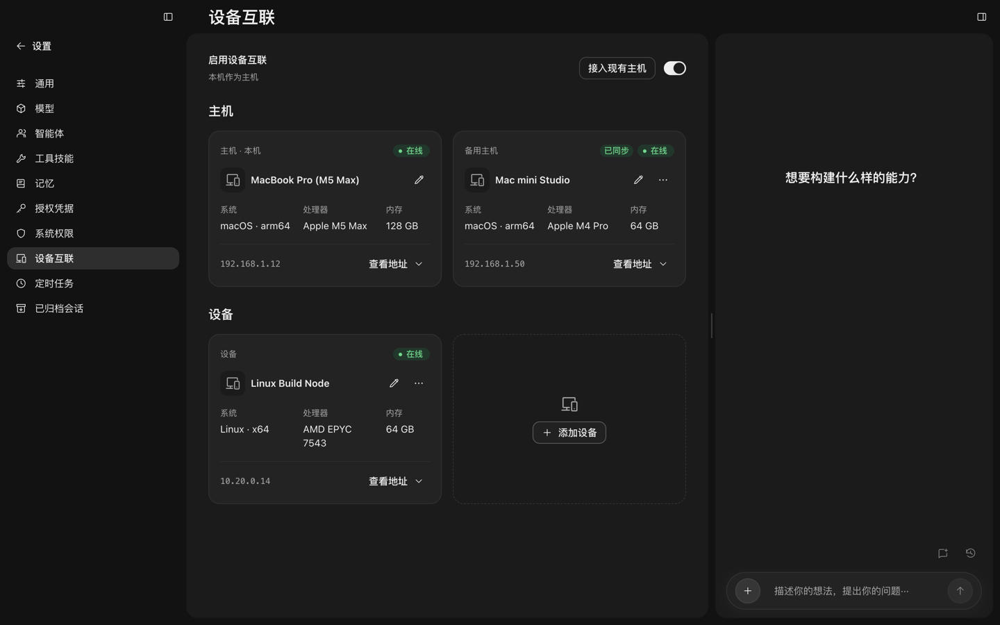
      <br><strong>多台电脑互联 + 多主机热备集群</strong><br>
      <sub>通过可续传反向隧道 <code>/ws/env</code> 串起 MacBook Pro、Mac mini Studio 与 Linux 节点，支持备用主机实时增量同步与断线自动升主。</sub>
    </td>
    <td width="50%" valign="top">
      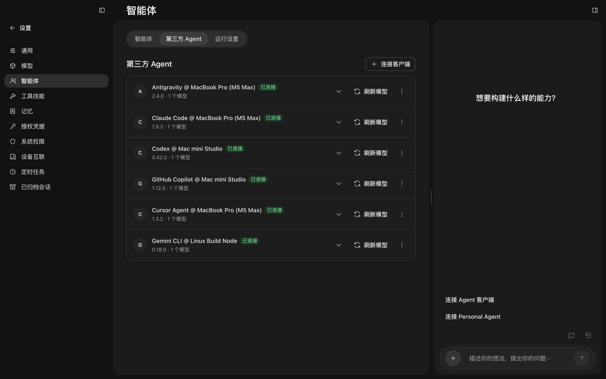
      <br><strong>连接 10+ 外部 ACP Agent + 6 大内置专家</strong><br>
      <sub>跨设备自动发现并调度 Antigravity、Claude Code、ChatGPT Codex、GitHub Copilot、Cursor、Gemini CLI 等，全部沿用原生登录与订阅。</sub>
    </td>
  </tr>
  <tr>
    <td width="50%" valign="top">
      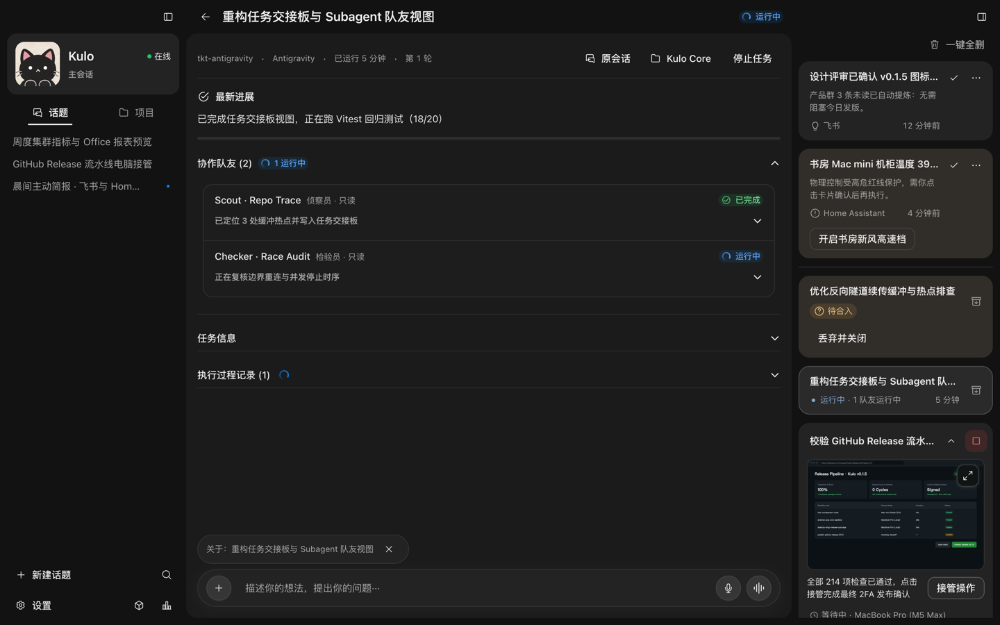
      <br><strong>隔离暂存区并行 + 协作队友交叉核验</strong><br>
      <sub>在任务详情中实时查看 Scout 侦察与 Checker 审计队友进度、主脑门控任务交接板与暂存区 Diff，核验通过后再合入仓库。</sub>
    </td>
    <td width="50%" valign="top">
      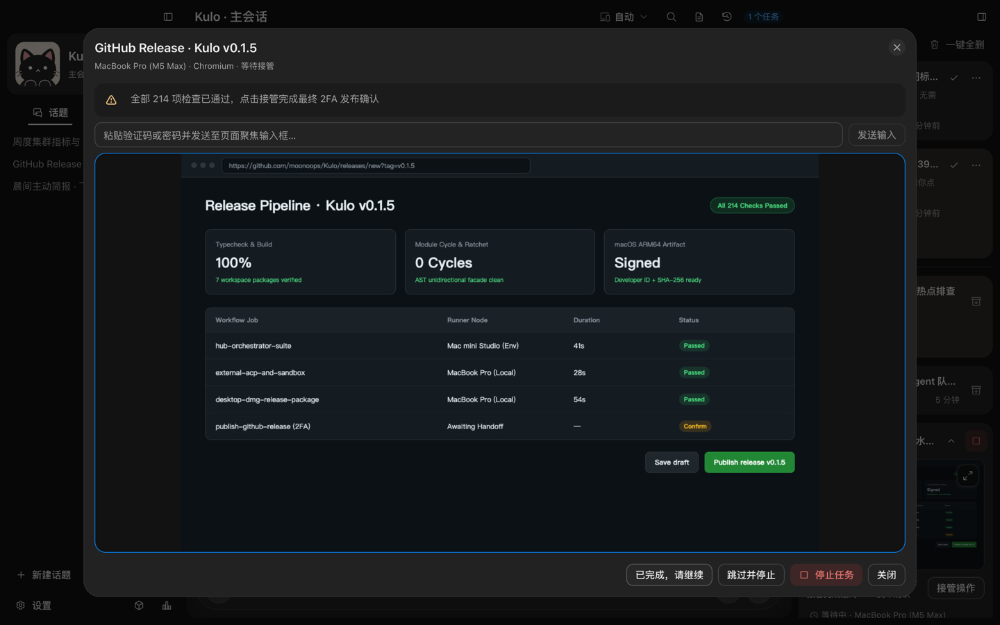
      <br><strong>浏览器与桌面实时预览 · 一键人工接管</strong><br>
      <sub>右侧实时推流 Kulo 操作电脑的画面；遇到 2FA 验证、登录或人工微调时点一下即刻接管，操作完点「已完成，请继续」交回执行。</sub>
    </td>
  </tr>
  <tr>
    <td width="50%" valign="top">
      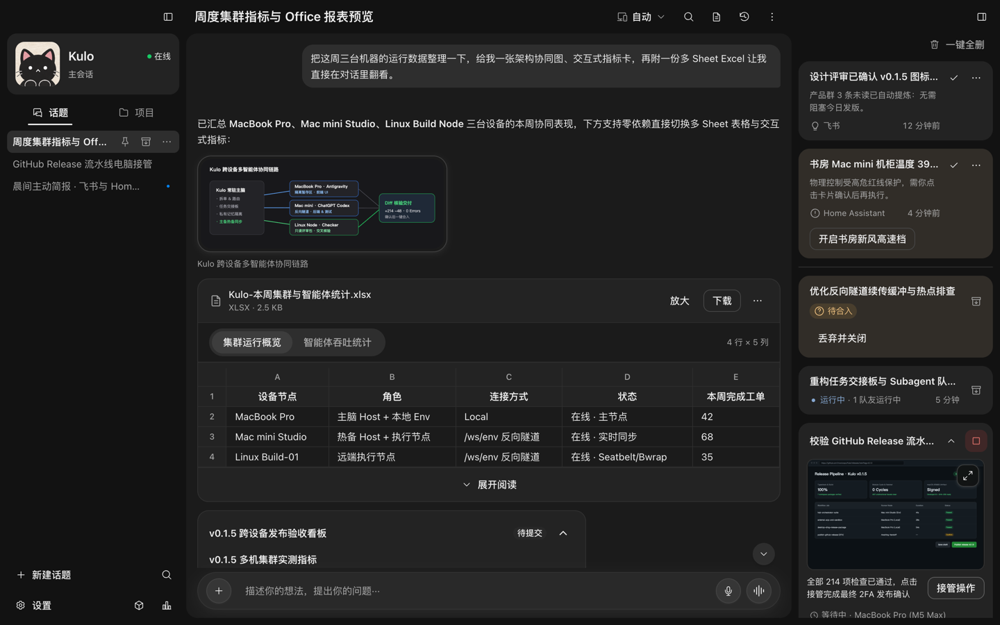
      <br><strong>内联架构图 · 零依赖 Office 预览 · 生成式 UI</strong><br>
      <sub>聊天里直接渲染校验后的矢量图示、免外部服务翻看多 Sheet Excel / Word / PPT / PDF，并用 20 种交互式 UI 卡片直接提交决策。</sub>
    </td>
    <td width="50%" valign="top">
      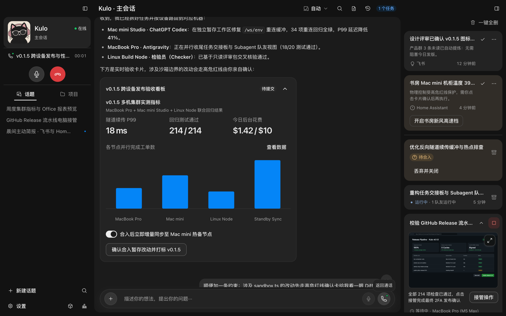
      <br><strong>全双工 Live 实时语音通话</strong><br>
      <sub>接入 OpenAI / Gemini / Vertex 实时语音，通话中随时自然打断且不遮挡主工作台；边走边派活，挂断后后台团队照常干完。</sub>
    </td>
  </tr>
  <tr>
    <td width="50%" valign="top">
      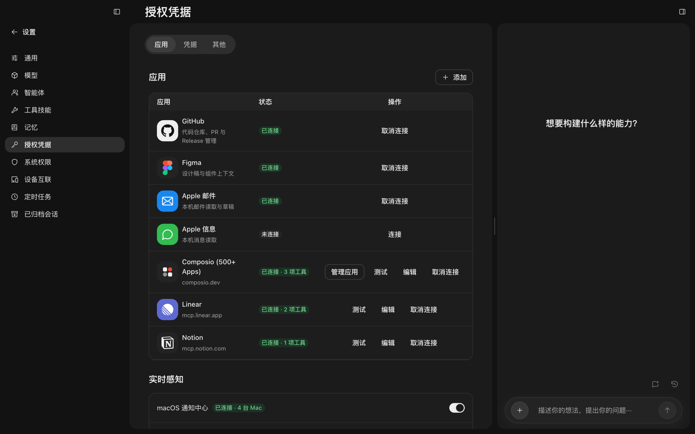
      <br><strong>主动感知 · 标准 MCP 智能接入 · Composio 500+</strong><br>
      <sub>统一管理 GitHub、Figma、Apple 邮件、Composio（500+ 应用）、Linear、Notion 与 macOS 通知中心，联动飞书、Spark 邮件与智能家居。</sub>
    </td>
    <td width="50%" valign="top">
      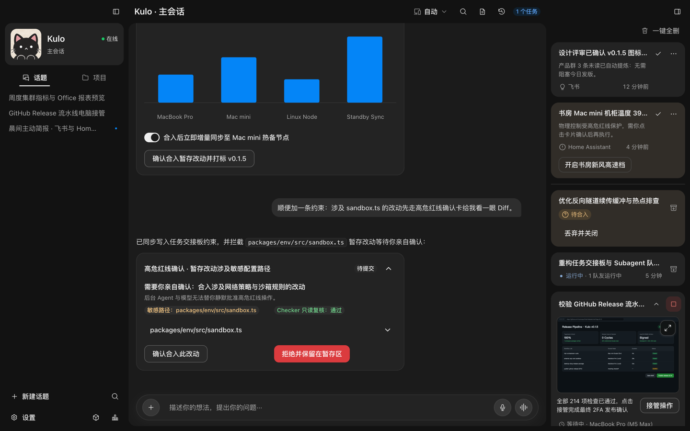
      <br><strong>三条高危红线原生确认卡</strong><br>
      <sub>日常任务静默流畅运行；涉及敏感路径合入、外部权限申请、界面自定制与物理家居控制时，必须通过原生确认卡由你亲自审批。</sub>
    </td>
  </tr>
</table>

<details>
<summary><strong>展开查看更多实机界面：浅色主题、双 Bank 私密记忆隔离与后台用量保护</strong></summary>

<br>

<table>
  <tr>
    <td width="33%" valign="top">
      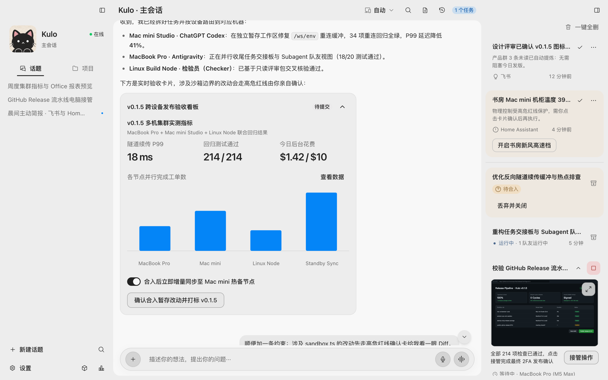
      <br><strong>原生浅色主题</strong><br>
      <sub>HeroUI v3 统一深浅语义 Token，主界面与弹窗风格完全一致。</sub>
    </td>
    <td width="33%" valign="top">
      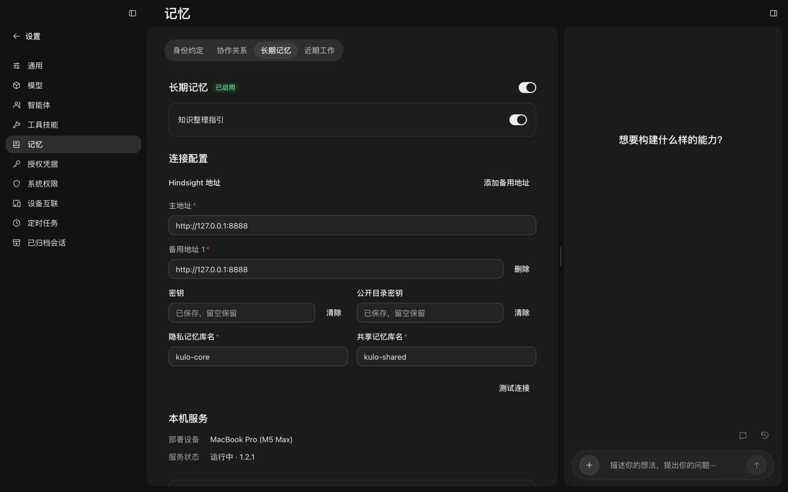
      <br><strong>双 Bank 私密记忆物理隔离</strong><br>
      <sub>服务端强隔离私库 <code>kulo-core</code> 与共享库 <code>kulo-shared</code>，后台物理不可越权。</sub>
    </td>
    <td width="33%" valign="top">
      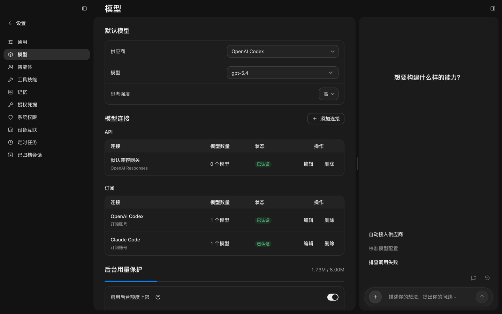
      <br><strong>后台用量保护与预算封顶</strong><br>
      <sub>统一管理 API 与 OAuth 订阅，设定每日/每周后台额度上限防止账单失控。</sub>
    </td>
  </tr>
</table>

</details>

---

<a id="quick-start"></a>
## 快速开始

### 1. macOS 桌面应用（macOS 14+，Apple Silicon）

- **直接安装**：前往 [GitHub Releases](https://github.com/moonoops/Kulo/releases/latest) 下载 **`Kulo-v0.1.7-macOS-arm64.dmg`**，双击挂载后将 **`Kulo.app`** 拖入 **`Applications`** 即可。
  - *说明*：正式版 DMG 已使用 Developer ID Application 证书签名（暂未走 Apple 公证）。首次打开如遇 macOS 安全提示，右键选择「打开」或运行一次：
    ```sh
    xattr -cr "/Applications/Kulo.app"
    ```
- **从源码构建安装**：
  ```sh
  pnpm desktop:install --launch
  ```

桌面端拥有独立数据目录（`~/Library/Application Support/Kulo`）、菜单栏托盘与未读角标、按会话聚合的原生通知、窗口状态记忆，以及打包期 Mach-O UUID 稳定化（跨版本升级保留系统权限）。

### 2. 从源码在本地运行

需要 **Node.js ≥ 22.20.0** 与 **pnpm 11.25.0**：

```sh
git clone https://github.com/moonoops/Kulo.git
cd Kulo
pnpm install
cp .env.example .env
```

编辑 `.env` 设置独立的随机 `KULO_AUTH_TOKEN`（建议至少 32 位）；模型 API 与 OAuth 订阅可在启动后直接在 Web 设置页配置（完整环境变量见 [.env.example](.env.example)）：

```sh
pnpm build
node packages/cli/dist/bin.js open
```

`open` 会启动 Hub 与内置本机 Env，并自动打开已认证的 Web 控制台（默认 `http://localhost:7788`）。

### 3. 接入更多设备与浏览器运行环境

- **添加设备**：打开「设置 → 设备互联 → 添加设备」，在目标设备运行一次性配对命令（`kulo join`）、使用 SSH 辅助部署（内置局域网扫描与主机指纹诊断），或**直接把配对邀请粘贴进对话**：
  ```sh
  node packages/cli/dist/bin.js join --hub <主脑地址> --invite <配对凭证>
  ```
- **浏览器自动化依赖**（源码节点）：
  ```sh
  pnpm --filter @kulo/env exec agent-browser install
  ```

---

<a id="multi-device"></a>
## 分布式多设备执行网格与多主机热备集群

在主力电脑或服务器上运行一台 **Host（`@kulo/hub`）**，再按需接入任意数量其他设备的 **执行节点（`@kulo/env`）**。Hub 承载常驻主脑、任务交接板与单一 SQLite 账本；每个 Env 提供受系统沙箱隔离的本地执行环境，让文件读写、终端、浏览器、桌面与外部 Agent 原地运行。

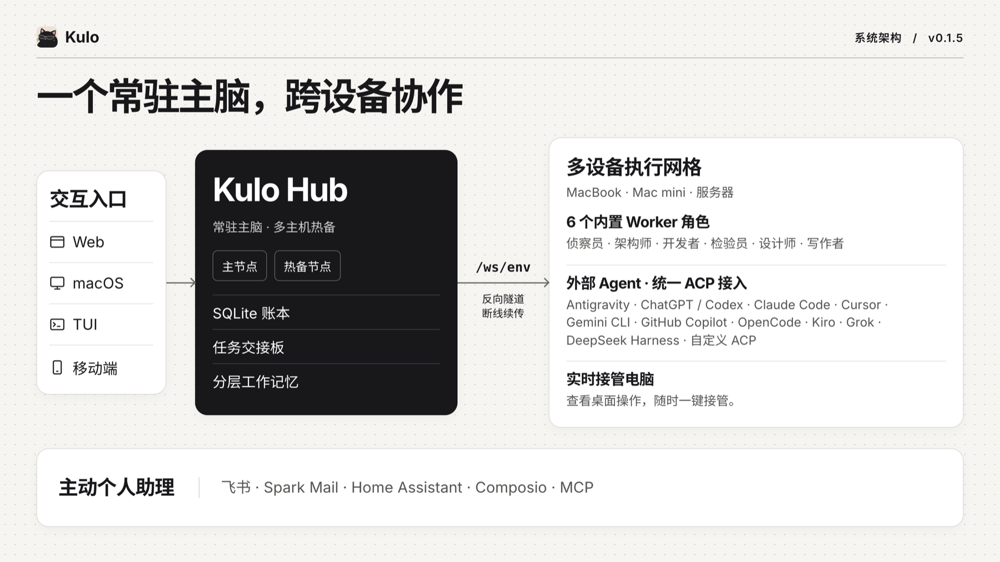

- **对话与执行彻底解耦**：在手机或轻薄本上发一句话，由工作站上的 Worker 改代码，或由另一台电脑操控浏览器。Host 内置本机 Env，单机即可起步，随时横向扩展更多设备。
- **可续传的反向隧道（`/ws/env`）**：执行节点凭独立节点凭据主动连向 Hub，无需公网 IP；内置累积确认流续传缓冲与休眠唤醒恢复，短暂断网不丢输出。
- **多主机热备集群（Hot Standby）**：支持配置主/备双主机集群，具备增量状态同步、预启动围栏（Pre-start Fence）、故障自动接管与无损回切，满足 24/7 常驻运行需求。
- **设备亲和路由**：自动识别本地路径、`localhost` 端口、桌面/浏览器等本机信号并绑定目标设备；目标机器离线时如实汇报，绝不暗中改派。
- **可选 Android 伴侣配对**：支持受管 TLS 连接器扫码配对、细粒度 Android 权限授权与通知投递。

底层基于 [Pi Durable](https://github.com/earendil-works/pi/tree/main/packages/durable)、[Pi Env](https://github.com/earendil-works/pi/tree/main/packages/env)、[Pi AI](https://github.com/earendil-works/pi/tree/main/packages/ai) 与 [Pi MCP](https://github.com/earendil-works/pi/tree/main/packages/mcp) 构建。

---

<a id="superagent"></a>
## SuperAgent：一个常驻主脑，混编内置专家与外部 ACP 智能体

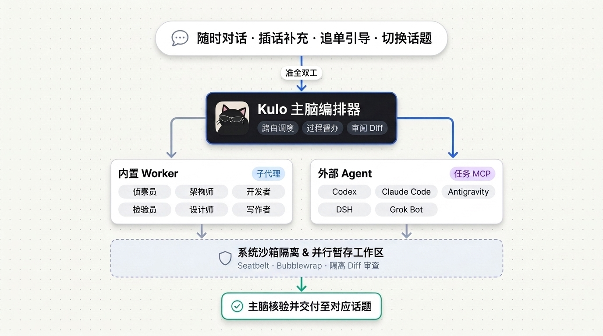

### 准全双工交互与跨话题连续性
主脑是你唯一的协作入口：新建话题只切换讨论空间，身份约定、工作记忆与统筹职责保持连续，并支持通过 SQLite FTS5 按权限跨话题检索，配合 `/ws/client` 请求回执（`hub.ack`）与 IndexedDB 离线重发队列。在主脑思考或后台任务推进期间，你可以随时插话补充约束、追单引导（`kulo_steer`）、直接终止任务决策或切换话题——后台任务绝不被误杀，完成后自动回到对应话题。

### 内置六大专家、任务交接板与并行暂存工作区
- **六大可定制内置角色**：**侦察员（Scout，只读摸底）**、**架构师（Architect，方案与子代理统筹）**、**开发者（Coder，实现与测试验证）**、**检验员（Checker，独立只读审查）**、**设计师（Designer，视觉与交互）**、**写作者（Writer，文档与内容）**，均支持独立配置模型、思考强度、提示词与权限边界。
- **任务交接板（`kulo_task_board`）与跨工单评审包**：主脑门控的交接板记录多智能体间的已核验结论、关键决策、约束与交接条目；支持物化跨工单只读评审包（`review_ticket_id`）、按工单派生子代理（`kulo_subagent`）、单子代理超时与可写中断熔断，以及任务详情内的队友可视化。
- **并行暂存工作区（Staged Workspaces）**：编码任务可在独立的写时复制（CoW）/ 克隆暂存目录并行执行，多 Worker 改同一仓库互不覆盖；只读角色的越权改动自动丢弃，主脑审阅 Diff 后再决定应用或放弃。

### 统一 ACP 外部智能体与任务级 MCP 协同
Kulo 采用统一的 **ACP（Agent Client Protocol）** 驱动架构与在线 ACP Registry 模板，原生扫描并调度各执行设备上已安装的本地外部智能体：

- **自动扫描与正式支持**：**Antigravity**、**ChatGPT / Codex**、**Claude Code**、**Cursor**、**Gemini CLI**、**GitHub Copilot**、**OpenCode**、**Kiro**、**Grok**、**DeepSeek Harness（`dsh`）**，以及**自定义 ACP** 智能体（并保留个人 Bot 桥接能力）。
- **原生账号零窃取 + 任务级 MCP**：外部 Agent 在绑定设备上沿用自身登录与订阅（支持 Codex / Antigravity 等外部额度实时探测），Kulo 通过统一的 `kulo-task` MCP 服务以增量方式注入任务上下文、汇报、协作请求、子任务派发、授权共享记忆与经审批的连接能力，同时完整保留用户本机原有的其他 MCP 配置。

---

<a id="multimodal"></a>
## 不止写代码：多模态工作台、电脑接管、Live 语音与主动助理

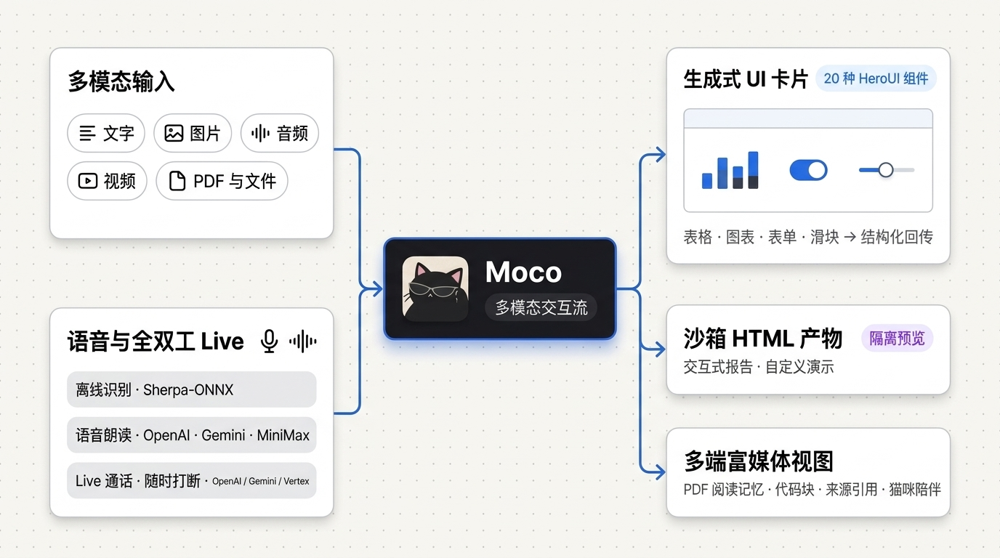

### 富交互多模态对话工作台
- **生成式 UI（`json-render` + HeroUI v3）**：Agent 可在对话中直接渲染 20 种受控交互组件（表格、柱状/折线图、表单、单/多选、滑块、开关、标签页、折叠面板、指标卡、媒体、代码等），你的交互结果以结构化数据回传继续推进任务。
- **内联 SVG 图示与沙箱 HTML 产物**：支持自动校验与步进动效的内联矢量图示，以及在隔离沙箱中安全呈现交互式 HTML 报告。
- **零依赖客户端 Office 与 PDF 预览**：无需外部服务即可在对话内或弹窗直接预览 **`.docx`**、**`.xlsx`**（多 Sheet 切换）、**`.pptx`**（幻灯片翻页）与带阅读进度记忆的 **PDF**，并跨轮持久化保留联网引用来源。
- **电脑操作实时预览与一键接管（Computer Handoff）**：按执行设备内置 `agent-browser` 与 `agent-desktop`，右侧实时推流操作画面——需要人工登录或微调时，直接在预览画面中点击一键接管控制，完成后交回给 Kulo 继续执行。

### 离线语音识别、朗读与全双工 Live 通话
- **语音输入（ASR）**：支持本地离线 **Sherpa-ONNX** 语音识别或云端模型。
- **语音播报（TTS）**：支持 **OpenAI**、**Gemini** 与 **MiniMax**（国内/国际版），内置服务端 Markdown 朗读清洗、音色与语速配置。
- **全双工 Live 实时通话**：接入 **OpenAI**、**Gemini** 与 **Vertex AI** Live 服务，实时语音、字幕与随时打断，共享当前话题上下文；通话中可直接把复杂任务交给主脑后台执行，挂断后继续推进。

### 主动个人助理与标准 MCP / 应用生态
- **感知闭环与主动简报**：可选开启 macOS 通知中心只读采集、SQLite 事件与摘要账本、本地（oMLX）或云端环境模型分拣、右栏置顶助理卡片与主动话题推送（内置自回声抑制）。
- **深度应用连接器**：支持 **飞书 / Lark**（`lark-cli` 双组织桥接）、**Spark Mail CLI**（本地/远端双路 RPC 与幂等确认卡）以及 **Home Assistant**（局域网状态镜像、安防哨兵与物理操作硬红线）。
- **标准 MCP 服务与云端聚合桥接**：基于 `@earendil-works/pi-mcp` 支持任意 HTTP / `stdio` MCP（OAuth / Bearer / 无鉴权）与 **智能粘贴解析器**（粘贴 `mcpServers` JSON 或 CLI 命令自动识别填充）；内置 **Linear**、**Notion**、**Atlassian**、**Sentry**、**Supabase**、**Vercel**、**Cloudflare**、**Stripe**、**Context7**、**DeepWiki**、**GitHub MCP**、**Figma MCP**、**Slack**、**PostHog** 等预设，并集成 **Composio**（500+ 应用）与 **Zapier**（9,000+ 应用）聚合桥接。

### HeroUI v3 三栏工作台与终端 TUI
- 统一默认浅色 / 深色双主题、动态猫咪陪伴形象（`CatAvatar`）、macOS 原生目录选择器、话题右键菜单与统一快捷键（`⌘/Ctrl+K` 全局搜索 · `⌘/Ctrl+F` 话题内查找 · `⌘/Ctrl+\` / `⇧⌘/Ctrl+\` 切换侧栏 · `⌘/Ctrl+.` 停止 · `⇧⌘/Ctrl+C` 复制最新回复 · `⌘/Ctrl+S` 保存）。
- 终端准全双工 TUI（`@kulo/cli`），随时通过 `kulo dev` 或 `kulo chat` 接入。

---

<a id="memory-security"></a>
## 分层记忆体系与纵深安全隔离

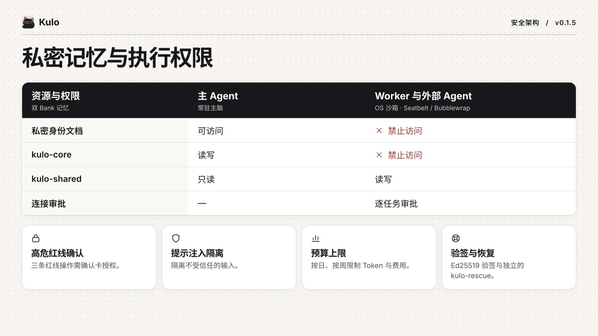

### 低延迟长上下文治理与双 Bank 语义记忆
- **工作记忆与上下文守卫**：内置上下文窗口守卫、主脑工具大输出自动溢出落盘、结构化**工作记忆**（全局 / 项目 / 话题作用域）、压缩前记忆刷盘与空闲压缩，让超长常驻会话依然低延迟且不丢关键决策。
- **私有身份与协作关系文档**：`<KULO_STATE_DIR>/identity` 中的 `identity-agreement.md`（双签 Diff 审阅 + SHA-256 与 CAS 锁）和 `relationship.md`**仅对主脑可见**，对后台 Worker 与外部 Agent 物理屏蔽。
- **可选 Hindsight 双 Bank 语义记忆**：可在设置中一键托管部署本地 Hindsight 或对接已加载 `integrations/hindsight` 授权扩展的 `hindsight-api-slim==1.2.1`；服务端通过独立 Bearer 密钥强隔离 `kulo-core` 与 `kulo-shared`，启动探活做负向越权验证，并支持记忆遗忘词条。默认关闭，详见 [integrations/hindsight/README.md](integrations/hindsight/README.md)。

### 零信任护栏、系统沙箱与费用上限
- **三条高危红线内嵌确认卡**：日常工作零打扰，仅在 3 条高危红线处弹出原生确认卡——持久化应用自定制 UI 构建、外部智能体权限申请（严禁模型替用户静默批准）、以及涉及敏感路径或冲突强制合并的暂存改动。
- **防注入与 Shell 安全底线**：外部不可信文本 XML / Harness 控制标记转义隔离（`provenance.ts`）、POSIX Shell 安全底线分类器（`shell-safety-floor.ts`）以及外部智能体环境变量密钥净化。
- **OS 级沙箱与系统密钥库**：内置 Worker 运行在 macOS Seatbelt、Linux Bubblewrap 或 Windows 受限隔离中，屏蔽 Hub 状态与 `.ssh`、`.gnupg`、`.kube`、`.aws`、`.claude`、`.codex`、`.gemini`；系统密钥库加密管理应用/SSH/MCP/自定义凭据，配合入站脱敏、API Key 原服务 Origin 严格绑定与逐任务审批。
- **日/周用量预算上限（Usage Caps）**：可为后台任务设定每日与每周 Token / 费用上限，并通过侧栏 Popover 实时查看用量统计。
- **受管界面定制与 `kulo-rescue` 独立救援**：macOS 桌面端支持在隔离候选构建中定制自身 Web UI，执行启动健康检查、Ed25519 官方更新验签与失败自动回退；主程序之外保留零业务依赖的 `kulo-rescue` 工具用于诊断、回滚、安全模式与脱敏导出。

---

<a id="capabilities"></a>
## 能力全景与 CLI 速查


<details>
<summary>展开查看完整能力与供应商明细</summary>

| 能力模块 | 说明 |
| --- | --- |
| **模型与认证** | 支持 Pi AI 内置 OAuth 订阅（OpenAI/Codex、Anthropic、OpenRouter、GitHub Copilot、Kimi Coding、xAI 等）、内置 `models.dev` / `litellm` 元数据注册表与批量校准，以及主流 API 预设（OpenAI、Gemini、Vertex AI、Anthropic、DeepSeek、OpenRouter、xAI、Moonshot、MiniMax、智谱 Z.AI、通义千问、Groq、Mistral 及任意 OpenAI 兼容网关）。 |
| **联网搜索** | 多方案优先级回退：免 Key **Exa** MCP、**Tavily**、**Brave** 与可选 **DuckDuckGo**，支持按模型开关原生联网工具与跨轮保留来源引用。 |
| **电脑操作** | 按执行设备内置 `agent-browser` 与 `agent-desktop`，支持实时画面预览、系统权限诊断与交互接管（Computer Handoff）；可通过 `KULO_COMPUTER_USE` 独立开关。 |
| **技能与长上下文** | 条件预设技能、Vercel `skills` 发现与项目级技能，内置 **Billion Context / `acp-kernel`** 压缩内核、上下文守卫与工具输出溢出落盘。 |
| **生图与视频** | OpenAI、Gemini 与 Vertex 生图/改图预设（模型隔离与多图参考）以及浏览器 Flow 会话衔接。 |
| **连接与 MCP** | 系统密钥库保护的 Apple 信息/邮件、GitHub、Figma、SSH（局域网扫描与指纹诊断）、飞书/Lark、Spark 邮件、Home Assistant、Composio/Zapier 与标准 HTTP/stdio MCP 服务。 |
| **定时任务** | 通过自然语言安排一次性或周期性后台任务。 |
| **设置助手** | 设置页内置对话式配置助手，安全引导完成模型、搜索、记忆、设备、技能与连接配置。 |

</details>

<details>
<summary>展开查看 CLI 常用命令与平台支持</summary>

### CLI 常用命令

| 命令 | 说明 |
| --- | --- |
| `node packages/cli/dist/bin.js open [--no-open]` | 启动 Hub + 本机 Env 并打开认证后的 Web 控制台 |
| `node packages/cli/dist/bin.js dev [--port 7788] [--no-tui] [--standalone]` | 连接已配对主脑，或单机启动本地 Hub 与终端 TUI |
| `node packages/cli/dist/bin.js join --hub <地址> --invite <凭证> [--root ~/Kulo]` | 作为执行节点配对加入已有主脑 |
| `node packages/cli/dist/bin.js hub [--host 0.0.0.0] [--port 7788] [--no-local-env]` | 独立启动常驻 Hub 服务 |
| `node packages/cli/dist/bin.js env --connect <ws地址> --id <env-id> --token <节点凭据>` | 独立启动执行节点并反向注册至 Hub |
| `node packages/cli/dist/bin.js chat [--url ws://127.0.0.1:7788/ws/client] [--token <token>]` | 打开终端准全双工 TUI 客户端 |
| `kulo-rescue <inspect\|versions\|rollback\|export\|gc\|safe-mode\|cleanup> --data-dir <路径>` | 独立版本诊断、回滚、安全基线恢复与清理工具 |

### 平台支持

| 组件 | 当前支持范围 |
| --- | --- |
| **Web 客户端** | 电脑、平板与手机上的现代浏览器 |
| **桌面应用** | macOS 14+（Electron 外壳 + 独立便携 Node 运行时；当前打包脚本面向 macOS） |
| **Hub** | Node.js ≥ 22.20 服务（macOS / Linux / Windows）；执行任务需至少连接一个 Env |
| **macOS Env** | 内置 Seatbelt 沙箱；桌面自动化需授予辅助功能与屏幕录制权限 |
| **Linux / Windows Env** | 需对应平台隔离后端（Bubblewrap / Windows 受限隔离）；桌面操作需交互式图形会话 |

</details>

<a id="faq"></a>
## 常见问题

**Kulo 和 T3 Code 这类单机多开 Coding Agent 面板有什么区别？**
多开面板解决的是“人在一台开发机上管理多个代码线程”；Kulo 在所有工具之上放了一个**常驻个人主脑**：你只提一个目标，主脑跨**多台物理设备**（带多主机热备）拆解并调度内置 6 大专家 + 外部 ACP 智能体协同与交叉审核，并把能力从写代码延伸到电脑操作实时接管、生成式 UI、Office 在线预览、全双工 Live 语音与主动个人助理——同时提供物理隔离的私密记忆与每日/每周预算上限。

**必须有多台设备才能使用 Kulo 吗？**
不需要。单台电脑即可同时运行 Hub 与内置本机 Env，后续随时接入更多设备或备机 Host。

**自托管是否意味着模型必须在本地运行？**
你托管的是 Hub、SQLite 账本、身份文档与执行节点；模型推理位置取决于你的配置，可使用本地模型（如 oMLX / Ollama），也可对接云端 API 或 OAuth 订阅。

**为什么手机通过局域网 HTTP 打开后无法录音或发起 Live 通话？**
浏览器麦克风采集与实时语音依赖安全上下文（`https://` 或 `localhost`）及麦克风权限，普通 `http://<局域网IP>` 会被浏览器限制。

<a id="development"></a>
## 开发与贡献

仓库采用 TypeScript + pnpm monorepo 结构：

| 模块 | 职责 |
| --- | --- |
| [`packages/hub`](packages/hub) | 主脑编排器、任务交接板、任务看板、模块化 HTTP/WS 路由、工具体系、工作记忆、密钥库与 SQLite 账本 |
| [`packages/env`](packages/env) | 执行节点、OS 沙箱、暂存工作区、电脑操作与统一 ACP 外部智能体驱动 |
| [`packages/web`](packages/web) | React 19 + Vite + Tailwind CSS v4 + HeroUI v3 工作台 |
| [`packages/desktop`](packages/desktop) | Electron macOS 桌面外壳、菜单栏托盘、原生目录选择器、双通道签名与打包脚本 |
| [`packages/cli`](packages/cli) | 命令行入口与终端 TUI |
| [`packages/protocol`](packages/protocol) | 共享领域类型、Schema、工具目录与通信协议 |
| [`packages/recovery`](packages/recovery) | 制品清单验签、自动回退与独立 `kulo-rescue` 运行时 |
| [`integrations/hindsight`](integrations/hindsight) | Hindsight 1.2.1 进程内双 Bank 记忆授权扩展 |

提交 PR 前请运行全量检查（含 AST 运行时依赖环守卫与文件行数棘轮检查）：

```sh
pnpm typecheck
pnpm build
pnpm test
```

修改 Hindsight 集成时，请同时运行 Python 测试套件（需要 `uv`）：

```sh
pnpm test:hindsight
```

欢迎提交 Issue、建议和 Pull Request。问题反馈请附复现步骤与脱敏日志，修改功能时请保持中英文 README 同步。更多细节见 [CHANGELOG.md](CHANGELOG.md)、[.env.example](.env.example)、[integrations/hindsight/README.md](integrations/hindsight/README.md) 与 [THIRD_PARTY_NOTICES.md](THIRD_PARTY_NOTICES.md)。

<a id="acknowledgements"></a>
## 致谢

Kulo 建立在众多优秀开源项目与社区分享之上，特别感谢：

- [Pi](https://github.com/earendil-works/pi) — Pi Durable、Pi Env、Pi AI、Pi MCP、Pi Schema 与 Chord 提供持久会话、模型接入、MCP 连接与执行环境基础。
- Vercel Labs — [json-render](https://github.com/vercel-labs/json-render)、[skills](https://github.com/vercel-labs/skills)、[agent-skills](https://github.com/vercel-labs/agent-skills)、[agent-browser](https://github.com/vercel-labs/agent-browser) 与 [agent-desktop](https://github.com/vercel-labs/agent-desktop)。
- [acp-kernel](https://github.com/ranxianglei/acp-kernel) 与 [Billion Context](https://github.com/ranxianglei/billion-context) 提供长上下文压缩能力。
- [Hindsight](https://github.com/vectorize-io/hindsight) 提供双 Bank 长期语义记忆能力。
- [HeroUI](https://github.com/heroui-inc/heroui) 提供 v3 界面组件库。
- [Sherpa-ONNX](https://github.com/k2-fsa/sherpa-onnx) 提供本地离线语音识别能力。
- [LINUX DO](https://linux.do/) 社区的交流与知识分享。

完整依赖许可与保留归属见 [THIRD_PARTY_NOTICES.md](THIRD_PARTY_NOTICES.md)。

<a id="license"></a>
## 开源协议

Kulo 原创代码采用 **GNU Affero General Public License v3.0 only（AGPL-3.0-only）**，完整条款见 [LICENSE](LICENSE)。第三方依赖、随附技能与其他上游材料保留各自许可，见 [THIRD_PARTY_NOTICES.md](THIRD_PARTY_NOTICES.md)。

<a id="star-history"></a>
## Star History

<a href="https://www.star-history.com/?repos=moonoops%2FKulo&type=date&legend=top-left">
 <picture>
   <source media="(prefers-color-scheme: dark)" srcset="https://api.star-history.com/svg?repos=moonoops/Kulo&type=Date&theme=dark" />
   <source media="(prefers-color-scheme: light)" srcset="https://api.star-history.com/svg?repos=moonoops/Kulo&type=Date" />
   
 </picture>
</a>
